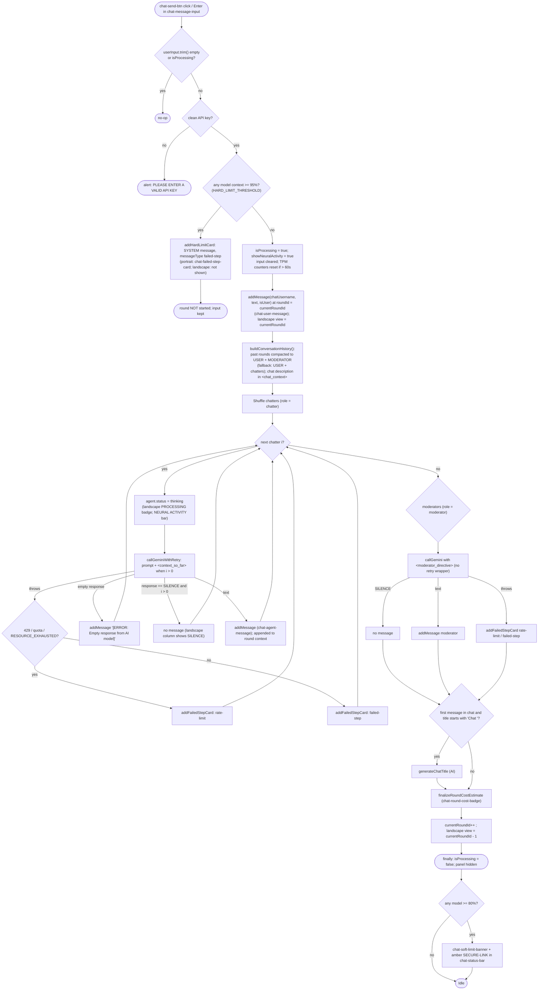

# Flow: Chat Round (As-Built)

| Field | Value |
| :--- | :--- |
| **Status** | As-built reference |
| **Version** | v1.0 |
| **Date** | 2026-11-23 |
| **Author** | Eunice (UI/UX Designer) |
| **PRD modules** | ORCH (primary), CHAT, OPER |
| **Stories / shards** | ORCH-001 (round-robin cycles), ORCH-002 (silence and synthesis), ORCH-003 (chat and file context), ORCH-004 (failed steps), OPER-001 (cost estimate), OPER-002 (soft/hard limits), OPER-003 (context compaction) |
| **Screens** | [Wireframe_Chat.md](Wireframe_Chat.md) (portrait), [Wireframe_ChatRoundtable.md](Wireframe_ChatRoundtable.md) (landscape + status bar) |
| **Source** | `tachikoma-chat.component.ts`: `triggerProtocol()`, `buildConversationHistory()`, `callGeminiWithRetry()`, `callGemini()`, `addMessage()`, `addFailedStepCard()`, `addHardLimitCard()`, `contextSoftWarning`, `finalizeRoundCostEstimate()`, `generateChatTitle()` |

The flow runs from send, through the chatters and the moderator, and covers silence, failed steps, and the soft and hard limits.

## 1. Full Navigation Flow

## 2. Happy Path Callout

1. The user types and clicks `chat-send-btn`.
2. `chat-user-message` appears (portrait). In landscape, the prompt preview updates and the round indicator stays on the active round.
3. Each chatter in shuffled order shows `thinking`, then a `chat-agent-message` card (portrait) or column content (landscape).
4. The moderator speaks last, with its synthesis.
5. A `chat-round-cost-badge` is added (portrait), `currentRoundId` increments, and the status bar `ROUND` and the nav indicator update.
6. Every message is saved straight away (`saveCurrentChat()` on each `addMessage`, local-first, then cloud sync by `ChatStorageService`).

## 3. State Machine

```mermaid
stateDiagram-v2
    [*] --> Idle
    Idle --> Blocked: hard limit (>= 95%)
    Blocked --> Idle: hard-limit card added (start a new chat to clear)
    Idle --> Idle: blank input / no key (alert)
    Idle --> UserPosted: send
    UserPosted --> ChatterThinking
    state ChatterThinking {
        [*] --> Calling
        Calling --> Retrying: 429 (not daily quota), up to MAX_RETRY_ATTEMPTS = 3, exponential backoff
        Retrying --> Calling
        Calling --> Spoke
        Calling --> Silent: SILENCE and not first chatter
        Calling --> Failed: error / daily quota
    }
    ChatterThinking --> ChatterThinking: next chatter
    ChatterThinking --> ModeratorThinking: chatters exhausted
    ModeratorThinking --> Finalizing: spoke / SILENCE / failed
    Finalizing --> Idle: cost finalized, currentRoundId++
    Idle --> SoftWarning: context >= 80%
    SoftWarning --> Idle: (persists while >= 80%; only a new chat resets metrics)
```

## 4. Route Map

| Node | Route | Layout | Auth requirement |
| :--- | :--- | :--- | :--- |
| Portrait transcript | `/tachikoma` with `!isLandscape()` | `FullComponent` | Public; needs a Gemini API key (local or profile) |
| Landscape roundtable | `/tachikoma` with `isLandscape()` | `FullComponent` | Same |
| Profiles (agent config) | `/tachikoma-profiles` | `FullComponent` | Public |
| Profile (API key, RPM tier) | `/profile` | `FullComponent` | Content requires `isAuthenticated()` |

## 5. Error & Edge Case Paths

| # | Case | Behaviour | Visible as |
| :--- | :--- | :--- | :--- |
| R1 | Blank input | Silently ignored | Nothing |
| R2 | Double send while processing | Ignored (`isProcessing`). The Send button is never disabled. | Nothing |
| R3 | No API key | `alert('PLEASE ENTER A VALID API KEY')` | Native browser dialog |
| R4 | **Network failure / API error** on a chatter | Retried only for 429 (not daily quota), then a failed-step card; **the round continues** with the remaining agents | `chat-failed-step-card` (portrait) / failed-step HTML in the column (landscape) |
| R5 | **Daily quota exhausted** | No retry; `rate-limit` card | `chat-failed-step-card.rate-limit-card` "Daily API quota exhausted..." |
| R6 | Moderator failure | `callGemini` without the retry wrapper; the card still says "Attempts: 3" | Failed-step card |
| R7 | Empty model response | `[ERROR: Empty response from AI model]` as a normal agent message | `chat-agent-message` |
| R8 | **Silence** | Chatters at index > 0 returning exactly `SILENCE` (punctuation stripped) produce no message. **The first chatter cannot be silent**: its "SILENCE" is shown as text. A moderator returning SILENCE produces no message. | Portrait: card absent. Landscape: SILENCE placeholder. |
| R9 | **Soft limit** (≥ 80% of `inputTokenLimit` on any model) | Banner plus an amber status-bar sync segment; the round still runs | `chat-soft-limit-banner`, `chat-status-bar` |
| R10 | **Hard limit** (≥ 95%) | The round is blocked before the user message is added; a hard-limit message is saved | Portrait: `chat-failed-step-card` with generic copy (see Wireframe_Chat observation 2). Landscape: **not rendered**. |
| R11 | RPM throttle | `callGemini` spaces requests (`MIN_REQUEST_INTERVAL_MS = 1000`, window 60s against `maxRequestsPerMinute`) | Status bar `RPM` warn/danger colours |
| R12 | Auth expiry mid-round | No special handling; local saves continue | n/a |
| R13 | **Empty state** | New chat: the intro text only. Landscape before the first prompt: columns show `—` and the nav says "No prompt yet". | n/a |
| R14 | **Reload mid-conversation** | `loadCurrentChat()` sets `currentRoundId = lastMessage.roundId` (not +1). The next prompt reuses the last round's id, so in landscape it **merges into the previous round** (`getUserPromptForRound` returns the first user message of that round), and context compaction treats the old round as active. The cost estimates (`roundTokenEstimates`) are session-only and lost on reload. | Round label and content anomalies |
| R15 | Navigating away mid-round | The component is destroyed, and the in-flight `triggerProtocol` keeps calling `addMessage` on the destroyed instance. Persistence of late messages was not determined. | Unknown |

## Notes

- `silenceProtocol` (standard / always_speak / conservative / agreeable) is stored on profiles but **not read by the orchestration**. Silence behaviour comes only from the system-prompt text and the `i > 0` check.
- Chatter order is shuffled every round, whereas the v1.0 landscape spec drew a fixed column sequence.
