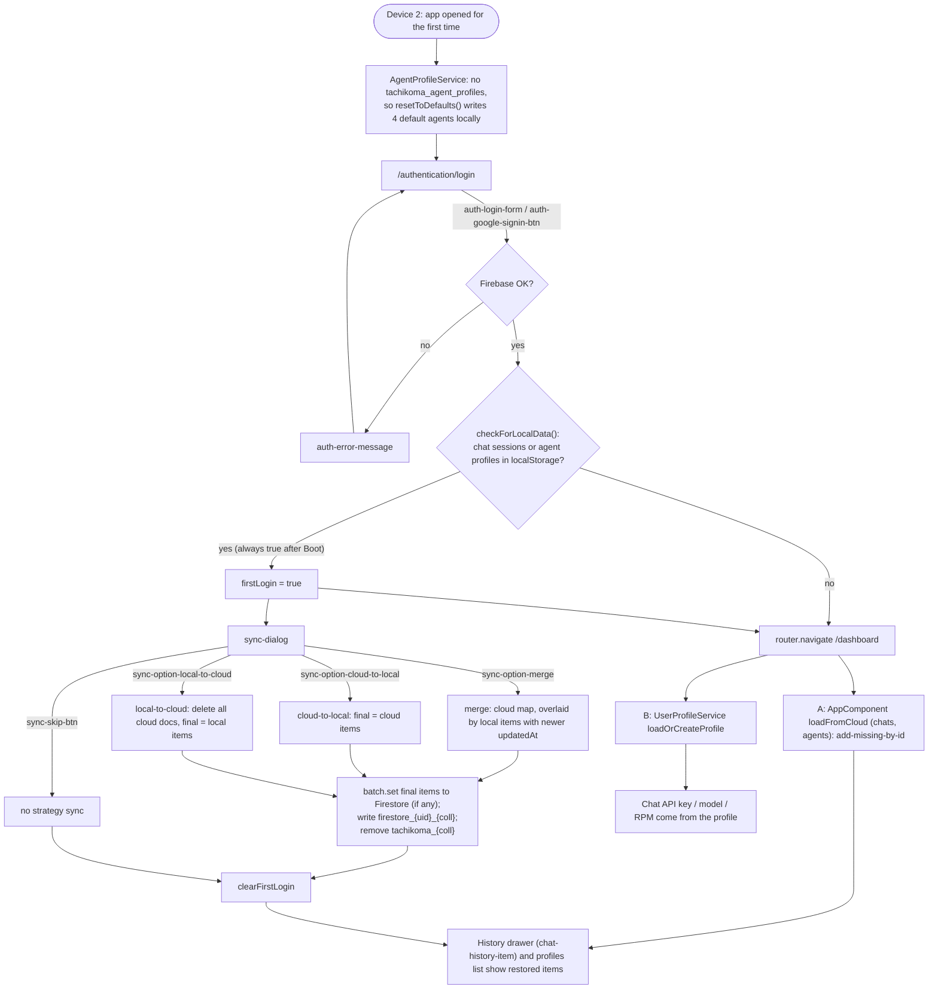

# Flow: Restore Across Devices (As-Built)

| Field | Value |
| :--- | :--- |
| **Status** | As-built reference |
| **Version** | v1.0 |
| **Date** | 2026-11-23 |
| **Author** | Eunice (UI/UX Designer) |
| **PRD modules** | SYNC (primary), AUTH |
| **Stories / shards** | SYNC-002 (restore across devices), AUTH-003 (first-login sync strategy), SYNC-001 (local-first), SYNC-004 (namespace) |
| **Screens** | [Wireframe_Login.md](Wireframe_Login.md), [Wireframe_Dialogs.md](Wireframe_Dialogs.md) (sync dialog), [Wireframe_Chat.md](Wireframe_Chat.md) (history drawer shows restored chats), [Wireframe_AgentProfiles.md](Wireframe_AgentProfiles.md), [Wireframe_UserProfile.md](Wireframe_UserProfile.md) |
| **Source** | `app.component.ts` (`handleAuthStateChange`, `checkAndSyncFromFirestore`), `services/chat-storage.service.ts` (`loadFromCloud`), `services/agent-profile.service.ts` (`loadProfiles`, `resetToDefaults`, `loadFromCloud`), `services/user-profile.service.ts` (auth effect), `services/firestore.service.ts` (`syncOnLogin`, `syncCollection`, `getLocalStorageKey`), `services/auth.service.ts` (`checkForLocalData`) |
| **E2E** | `e2e/specs/sync/sync.spec.ts` T405–T413 |

The flow covers an authenticated sign-in on a fresh device and the sync dialog's merge, local and cloud branches.

## Two restore mechanisms run on a real sign-in

| Mechanism | Trigger | What it does | Writes to |
| :--- | :--- | :--- | :--- |
| **A. Automatic cloud load** | `AppComponent` effect on the first non-null `user` with `isLoading()` false, real users only (`isRealUser()`) | `ChatStorageService.loadFromCloud()` and `AgentProfileService.loadFromCloud()`: **add only cloud items whose id is not already local**. Local copies win on id collision and nothing is deleted. | Service signals and `tachikoma_chat_sessions` / `tachikoma_agent_profiles` |
| **B. User profile load** | `UserProfileService` effect on `authService.user()` | `loadOrCreateProfile(uid)` reads or creates the Firestore user profile (API key, model, RPM, username) | Profile signal (+ `tachikoma_user_profile`) |
| **C. Sync dialog strategy** (AUTH-003) | Login-page effect when `firstLogin` (local data present) | `FirestoreService.syncOnLogin(strategy)` over `chat_sessions`, `user_profile` and `agent_profiles` | **Firestore**, and `firestore_{uid}_{collection}` localStorage keys. It **removes** `tachikoma_{collection}` keys (see Edge paths). |

A, B and C all run on a typical real sign-in, in no guaranteed order.

## 1. Full Navigation Flow

## 2. Happy Path Callout

1. On device 1 the user signs in, chats, and the chats sync to the cloud (`ChatStorageService.syncChatToCloud` on each save).
2. On device 2, a fresh browser, the user signs in with the same account using `auth-login-form`.
3. Because the defaults were written to localStorage on boot, the **sync dialog appears** (`sync-dialog`). The user picks **Merge** (`sync-option-merge`, marked "Recommended").
4. Mechanism A adds the device-1 chats to the local list, so they appear as `chat-history-item` rows in the chat history drawer. Mechanism B restores the API key, model and RPM from the profile.
5. Default agents with fixed ids (`logikoma`, `ghost`, `moderator`, `neutral`) collide with cloud copies. A keeps the **local** defaults, so cloud edits to default agents are not adopted by A.

## 3. State Machine (sync dialog branches)

```mermaid
stateDiagram-v2
    [*] --> SignedIn
    SignedIn --> DialogOpen: firstLogin and isAuthenticated
    SignedIn --> AutoLoadOnly: no local data (rare; see E1)
    DialogOpen --> Merge: sync-option-merge
    DialogOpen --> CloudWins: sync-option-cloud-to-local
    DialogOpen --> LocalWins: sync-option-local-to-cloud
    DialogOpen --> Skipped: sync-skip-btn
    Merge --> Persisted
    CloudWins --> Persisted
    LocalWins --> CloudWiped: delete all cloud docs per collection
    CloudWiped --> Persisted: batch.set local items
    Persisted --> Done: clearFirstLogin
    Skipped --> Done
    AutoLoadOnly --> Done
```

## 4. Route Map

| Node | Route | Layout | Auth requirement |
| :--- | :--- | :--- | :--- |
| Login | `/authentication/login` | `BlankComponent` | Public |
| Sync dialog | Overlay (normally on `/dashboard`) | `MatDialog`, `disableClose` | Real authenticated user |
| Dashboard | `/dashboard` | `FullComponent` | Public |
| Chat (verify restored chats) | `/tachikoma`, history drawer | `FullComponent` | Public |
| Agent profiles (verify restored agents) | `/tachikoma-profiles` | `FullComponent` | Public |
| Profile (manual re-sync) | `/profile`: `profile-sync-chats-btn`, `profile-sync-agents-btn` | `FullComponent` | Real user for sync |

## 5. Error & Edge Case Paths

| # | Case | What the code does |
| :--- | :--- | :--- |
| E1 | **"Fresh" device never skips the dialog** | `resetToDefaults()` runs on the first app load, so `tachikoma_agent_profiles` always exists by sign-in time and `checkForLocalData()` is true. The dialog's "You have local data on this device" copy is shown even when the only local data is the defaults. |
| E2 | **Strategies write to a different localStorage key than the app reads** | `syncCollection` stores the final data under `firestore_{uid}_{collection}` and **removes** `tachikoma_{collection}`. `ChatStorageService` and `AgentProfileService` read and write `tachikoma_chat_sessions` / `tachikoma_agent_profiles` and keep their in-memory signals. So: (a) the **cloud** side of the strategy (Firestore writes and deletes) takes effect; (b) the **local UI** keeps showing the pre-sync in-memory list until the next reload or save; (c) for **cloud-to-local**, local-only chats still in memory are written back to `tachikoma_chat_sessions` on the next save. The local side may not be discarded as the dialog copy promises. **E2E T409–T411 are the arbiter**; this could not be confirmed without running them. |
| E3 | **Local-to-cloud wipes the cloud** | All cloud docs in each collection are deleted before the local items are written. With an empty local list, nothing is re-written, so the cloud is emptied. |
| E4 | **Network failure during sync** | Each collection is wrapped in try/catch in `syncOnLogin`, so one failure does not stop the others. Errors are logged only, and the dialog is already closed. Firestore offline persistence (`enableOfflineSupport`) may queue writes. |
| E5 | **Network failure during the automatic load (A)** | Caught and logged ("Error syncing Firestore data"). The app continues with local data (SYNC-003 offline-first). |
| E6 | **Guest on a new device** | `isRealUser()` is false, so A and the manual sync are skipped. Guest sign-in never calls `checkForLocalData()`, so there is no dialog. T412 covers this. |
| E7 | **Empty cloud** | A logs "No chats/agent profiles found" and keeps the local defaults. Merge with an empty cloud writes the local items up. T413 covers this. |
| E8 | **Auth expiry / sign out and back in without a reload** | `hasCheckedInitialSync` stays true, so A does not run again. B re-runs, because its effect has no such guard. |
| E9 | **Validation** | None. The dialog has no inputs. |
| E10 | **Keyboard-only user** | The option cards are not focusable; only Skip can be reached by keyboard (see [Wireframe_Dialogs.md](Wireframe_Dialogs.md)). |

## Test hooks for Quinn

| Path | Selectors |
| :--- | :--- |
| Dialog shown | `sync-dialog` |
| Merge / cloud / local / skip | `sync-option-merge`, `sync-option-cloud-to-local`, `sync-option-local-to-cloud`, `sync-skip-btn` |
| Restored chats | `chat-history-toggle-btn`, then `chat-history-item` / `chat-history-item-title` |
| Restored agents | `profiles-card-name` |
| Restored settings | `profile-chat-username-preview`, `profile-model-select` |
