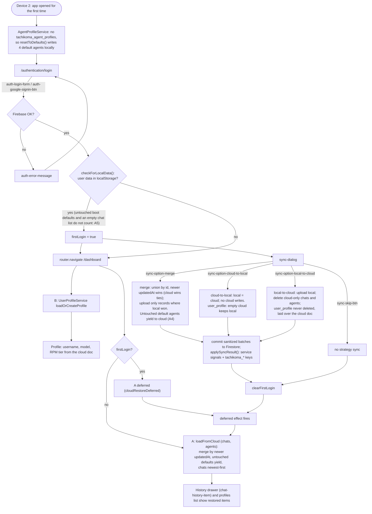
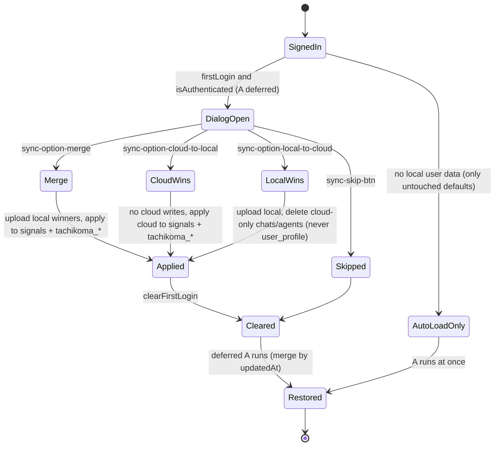

# Flow: Restore Across Devices (As-Built)

| Field | Value |
| :--- | :--- |
| **Status** | As-built reference, refreshed after the SYNC-002 fixes |
| **Version** | v1.2 |
| **Date** | 2026-11-25 |
| **Author** | Eunice (UI/UX Designer) |
| **PRD modules** | SYNC (primary), AUTH |
| **Stories / shards** | SYNC-002 (restore across devices), AUTH-003 (first-login sync strategy), SYNC-001 (local-first), SYNC-004 (namespace) |
| **Screens** | [Wireframe_Login.md](Wireframe_Login.md), [Wireframe_Dialogs.md](Wireframe_Dialogs.md) (sync dialog), [Wireframe_Chat.md](Wireframe_Chat.md) (history drawer shows restored chats), [Wireframe_AgentProfiles.md](Wireframe_AgentProfiles.md), [Wireframe_UserProfile.md](Wireframe_UserProfile.md) |
| **Source** | `app.component.ts` (`handleAuthStateChange`, `cloudRestoreDeferred` effect, `checkAndSyncFromFirestore`), `pages/authentication/side-login/side-login.component.ts` (passes the sync targets), `services/firestore.service.ts` (`cloudCopyWins`, `mergeSyncRecords`, `planCollectionSync`, `syncOnLogin`, `syncCollection`, `SINGLE_DOCUMENT_COLLECTIONS`, `SyncTarget`), `services/chat-storage.service.ts` (`loadFromCloud`, `mergeByUpdatedAt`, `sortByRecency`, `getLocalSyncData`, `applySyncResult`), `services/agent-profile.service.ts` (`loadFromCloud`, `yieldsToCloud`, `applySyncResult`), `models/agent-profile.model.ts` (`isUntouchedDefault`), `services/user-profile.service.ts` (auth effect, `getLocalSyncData`, `applySyncResult`, `toCloud`, `fromCloud`), `services/auth.service.ts` (`checkForLocalData`) |
| **E2E** | `e2e/specs/sync/sync.spec.ts` T405–T413, T427 (use-local keeps the cloud profile), T428 (merge keeps cloud edits to default agents) |

The flow covers an authenticated sign-in on a fresh device and the sync dialog's merge, local and cloud branches.

### Revision note

| Version | Date | Change |
| :--- | :--- | :--- |
| v1.2 | 2026-11-25 | Quinn, SYNC-002 re-gate (PASS). A4 landed (`66c609a`): one shared conflict rule, `cloudCopyWins` / `mergeSyncRecords`, for the merge strategy and both automatic restores. Untouched default agents yield to the cloud, otherwise the newer `updatedAt` wins, and the **cloud wins ties for chats and agents alike** (v1.1 said local won chat ties). E9 resolved; T428 passes. A5 landed: untouched defaults and an empty chat list no longer trigger the sync dialog, so E1 is resolved. |
| v1.1 | 2026-11-24 | Refreshed as built after the SYNC-002 fixes (commits `79c7294`, `3f4201a`). Strategies now run on the `tachikoma_*` keys and the service signals through `SyncTarget`, not on `firestore_{uid}_*` keys (old E2 resolved). `user_profile` is a single-document collection that is never deleted and is laid over the cloud doc (old E3 narrowed to chats and agents). The automatic restore (A) is deferred until the dialog resolves. Merges keep the newer `updatedAt`. Untouched default agents yield to cloud in A; the same rule in the merge strategy is the intended behaviour, **pending A4**. E1 (dialog on a device holding only boot defaults) is **being fixed by A5**. Happy-path step 5 rewritten. |
| v1.0 | 2026-11-23 | First as-built pass (pre-fix behaviour). |

## Restore mechanisms on a real sign-in

| Mechanism | Trigger | What it does | Writes to |
| :--- | :--- | :--- | :--- |
| **A. Automatic cloud load** | `AppComponent` effect on the first non-null `user`, real users only (`isRealUser()`). **If `firstLogin()` is true, A is deferred** (`cloudRestoreDeferred`) and runs from a second effect once `firstLogin` clears, i.e. after the sync dialog resolves (strategy or skip). | `ChatStorageService.loadFromCloud()` and `AgentProfileService.loadFromCloud()` merge cloud into local **by id with the shared rule `mergeSyncRecords`**: newer `updatedAt` wins and the cloud wins ties. A local default agent the user never edited (`isUntouchedDefault`) always yields to its cloud copy. Restored chats are sorted newest-first (`sortByRecency`). Nothing is deleted. | Service signals and `tachikoma_chat_sessions` / `tachikoma_agent_profiles` |
| **B. User profile load** | `UserProfileService` effect on `authService.user()` (not deferred) | `loadOrCreateProfile(uid)` reads the Firestore profile through `fromCloud` (decrypts `geminiApiKeyEncrypted`), or creates one | Profile signal + `tachikoma_user_profile` |
| **C. Sync dialog strategy** (AUTH-003) | Login-page effect when `firstLogin` (local data present) | `FirestoreService.syncOnLogin(strategy, targets)` over `chat_sessions`, `user_profile`, `agent_profiles` in that order. Each collection is read from and written back to its owning service (`SyncTarget`: `getLocalSyncData()` / `applySyncResult()`), and the plan comes from the pure `planCollectionSync()`. | **Firestore** (sanitized batches of at most 450 ops) **and** the same `tachikoma_*` keys and signals the UI reads |

Order on a first login: B starts at once. C runs when the user picks an option. A runs **after** C has finished and `firstLogin` is cleared, so it cannot race or undo the chosen strategy. Without the dialog, A and B run together.

## 1. Full Navigation Flow

## 2. Happy Path Callout

1. On device 1 the user signs in, chats and edits a built-in agent (for example renames `LOGIKOMA`). Chats and agents sync to the cloud on save.
2. On device 2, a fresh browser, the user signs in with the same account using `auth-login-form`.
3. A device holding only the untouched boot defaults skips the dialog and goes straight to step 6 (A5). If the device holds real local data (for example guest chats), the **sync dialog appears** (`sync-dialog`). The user picks **Merge** (`sync-option-merge`, marked "Recommended"). A is held back until this choice completes.
4. C merges each collection by id, keeping the newer `updatedAt`, and writes the result to the service signals and `tachikoma_*` keys, so the drawer and profiles list update without a reload. Only records where the local copy won are uploaded. `user_profile` is laid over the existing cloud doc, so cloud-only fields (`geminiApiKeyEncrypted`) survive.
5. **Default agents** (`logikoma`, `ghost`, `moderator`, `neutral`) exist on both sides with the same ids. A local default the user never edited yields to the cloud copy in every path (`yieldsToCloud` in `mergeSyncRecords`), so the device-1 rename is adopted and not overwritten. T428 covers the merge strategy.
6. When the dialog closes, `clearFirstLogin` fires the deferred A. It adds any cloud chats or agents still missing or newer, sorted newest-first, so the device-1 chats appear as `chat-history-item` rows. B has restored the username, model and RPM tier.

## 3. State Machine (sync dialog branches)

## 4. Route Map

| Node | Route | Layout | Auth requirement |
| :--- | :--- | :--- | :--- |
| Login | `/authentication/login` | `BlankComponent` | Public |
| Sync dialog | Overlay (normally on `/dashboard`) | `MatDialog`, `disableClose` | Real authenticated user |
| Dashboard | `/dashboard` | `FullComponent` | Public |
| Chat (verify restored chats) | `/tachikoma`, history drawer | `FullComponent` | Public |
| Agent profiles (verify restored agents) | `/tachikoma-profiles` | `FullComponent` | Public |
| Profile (manual re-sync) | `/profile`: `profile-sync-chats-btn`, `profile-sync-agents-btn` | `FullComponent` | Real user for sync |

## 5. Error & Edge Case Paths

| # | Case | What the code does |
| :--- | :--- | :--- |
| E1 | **Device holding only boot defaults** (resolved by A5) | `resetToDefaults()` runs on the first app load, so `tachikoma_agent_profiles` always exists by sign-in time. `checkForLocalData()` now counts only user data: untouched default agents (`AgentProfileModel.isUntouchedDefault`) and an empty chat list are ignored, so such a device skips the dialog and goes straight to A (T405–T408, T413). Unreadable local data still counts, so the user is asked first. A default the user deleted locally does not count either: the next restore brings it back from the cloud (accepted, Low). |
| E2 | **Strategy writes land where the app reads** (resolved in v1.1) | Strategies read `getLocalSyncData()` and write `applySyncResult()` on `ChatStorageService`, `AgentProfileService` and `UserProfileService`: the `tachikoma_*` keys and the signals. The UI reflects the result without a reload. The orphan `firestore_{uid}_*` keys are no longer written. cloud-to-local clears `currentChatId` if that chat is gone. An empty agent result falls back to the defaults locally. |
| E3 | **Local-to-cloud deletes cloud-only chats and agents** (narrowed in v1.1) | For `chat_sessions` and `agent_profiles`, cloud documents whose id is not local are deleted, then the local items are uploaded. An empty local chat list still empties the cloud chats (by design of "Use Local Data"). **`user_profile` is never deleted**: the local profile is laid over the existing cloud doc (`{ ...cloud, ...local }`), so `geminiApiKeyEncrypted` survives (T427). |
| E4 | **Unreadable or absent local copy** | `getLocalSyncData()` returns `null` (for example, no profile signal yet), so that collection is skipped and nothing is deleted on either side. |
| E5 | **Network failure during sync** | Each collection is wrapped in try/catch in `syncOnLogin`, so one failure does not stop the others. Per-collection errors are logged only. The login page shows "Sync failed, but you can continue using the app." only if `syncOnLogin` itself throws. Firestore offline persistence may queue writes. `clearFirstLogin` still runs, so A follows. |
| E6 | **Network failure during the automatic load (A)** | Caught and logged ("Error loading … from cloud"). The app continues with local data (SYNC-003 offline-first). |
| E7 | **Guest on a new device** | `isRealUser()` is false, so A and the manual sync are skipped. Guest sign-in never calls `checkForLocalData()`, so there is no dialog. T412 covers this. |
| E8 | **Empty cloud** | A logs "No chats/agent profiles found" and keeps the local defaults. Merge with an empty cloud uploads the local items (T413). cloud-to-local with an empty cloud empties local chats, falls back to default agents, and keeps the local `user_profile`. |
| E9 | **Default agent edited on another device** (resolved by A4) | An untouched local default yields to the cloud copy in the merge strategy and in A (`mergeSyncRecords` with `yieldsToCloud`), so the cloud edit is kept locally and is not uploaded over. T428 covers it. Known gap: there are no tombstones, so a default or chat **deleted** on another device comes back from this device on merge or on the next whole-set upload (Medium, product decision with Jason). |
| E10 | **Auth expiry / sign out and back in without a reload** | `hasCheckedInitialSync` stays true, so A does not run again. B re-runs, because its effect has no such guard. |
| E11 | **B and C both touch the profile** | B loads the cloud profile into the signal on auth while the dialog is open. C's `user_profile` step reads that signal. If B has not finished, the signal may still be empty and C skips `user_profile` (E4). Either way the cloud doc is never deleted. |
| E12 | **Validation** | None. The dialog has no inputs. |
| E13 | **Keyboard-only user** | The option cards are not focusable; only Skip can be reached by keyboard (see [Wireframe_Dialogs.md](Wireframe_Dialogs.md)). |

The profile's API key fields are part of the bring-your-own-key model and are **Deferred: Firebase AI Logic migration**. This flow documents how they survive a sync, but designs nothing new for them.

## Test hooks for Quinn

| Path | Selectors |
| :--- | :--- |
| Dialog shown | `sync-dialog` (use the `data-test-id`, not `app-sync-dialog, .sync-dialog`: triage T3) |
| Merge / cloud / local / skip | `sync-option-merge`, `sync-option-cloud-to-local`, `sync-option-local-to-cloud`, `sync-skip-btn` |
| Restored chats | `chat-history-toggle-btn`, then `chat-history-item` / `chat-history-item-title` (expect newest-first) |
| Restored agents | `profiles-card-name` |
| Restored settings | `profile-chat-username-preview`, `profile-model-select` |
| Strategy result without reload | Poll `tachikoma_chat_sessions` / `tachikoma_agent_profiles` in localStorage (as T410, T411 do) |
