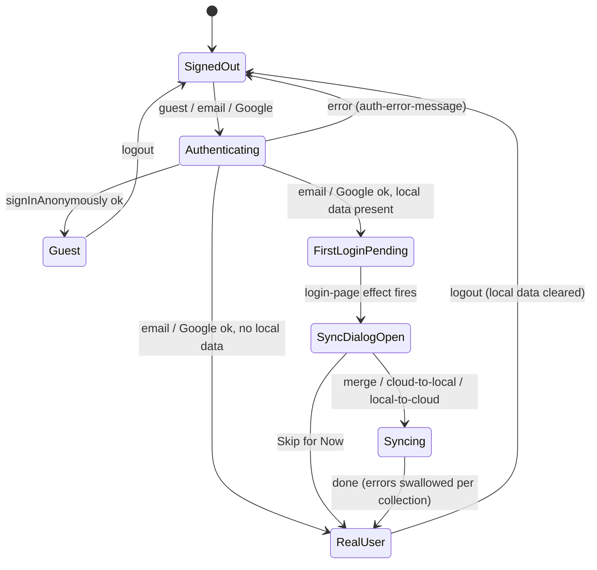

# Flow: Sign In (As-Built)

| Field | Value |
| :--- | :--- |
| **Status** | As-built reference |
| **Version** | v1.0 |
| **Date** | 2026-11-23 |
| **Author** | Eunice (UI/UX Designer) |
| **PRD modules** | AUTH, SYNC |
| **Stories / shards** | AUTH-001, AUTH-003, SYNC-002 (cloud load after a real sign-in) |
| **Screens** | [Wireframe_Login.md](Wireframe_Login.md), [Wireframe_Register.md](Wireframe_Register.md), [Wireframe_Dashboard.md](Wireframe_Dashboard.md), [Wireframe_Dialogs.md](Wireframe_Dialogs.md) |
| **Source files** | `side-login.component.ts`, `side-register.component.ts`, `services/auth.service.ts`, `app.component.ts`, `services/user-profile.service.ts`, `layouts/full/sidebar/nav-item/nav-item.component.ts`, `layouts/full/header/header.component.ts` |

The flow covers four sign-in paths (guest, email/password, Google, failed), the first-login sync dialog, and logout.

## 1. Full Navigation Flow

```mermaid
flowchart TD
    Start([User opens app]) --> AnyRoute{Route}
    AnyRoute -->|"/ or /dashboard (no guard)"| Dash0[Dashboard, unauthenticated]
    AnyRoute -->|/authentication/login| Login[Login: auth-login-card]
    Dash0 -->|sidebar Login / header menu Login| Login

    Login -->|auth-guest-btn| Guest["signInAnonymously()"]
    Login -->|auth-login-form submit| Email["signInWithEmailAndPassword()"]
    Login -->|auth-google-signin-btn| Google["signInWithPopup(Google)"]
    Login -->|auth-register-link| Register[Register: auth-register-card]

    Guest -->|ok| DashG[/dashboard as anonymous/]
    Guest -->|error| Err[auth-error-message] --> Login
    Email -->|error| Err
    Google -->|error| Err

    Email -->|ok| Check{"checkForLocalData():<br/>tachikoma_chat_sessions or<br/>tachikoma_agent_profiles present?"}
    Google -->|ok| Check
    Check -->|no| DashR[/dashboard as real user/]
    Check -->|"yes: firstLogin = true"| DashR2[/dashboard/] --> SyncDlg[sync-dialog]
    SyncDlg -->|sync-option-merge / -cloud-to-local / -local-to-cloud| SyncRun["firestoreService.syncOnLogin(strategy)"] --> Clear[clearFirstLogin] --> DashR
    SyncDlg -->|sync-skip-btn| Clear

    DashR --> Cloud["AppComponent effect (first user only):<br/>chatStorage.loadFromCloud() + agentProfile.loadFromCloud()"]
    DashR --> Prof["UserProfileService effect: loadOrCreateProfile(uid)"]
    DashG -.->|isRealUser() false| NoCloud[No cloud load]

    Register -->|auth-register-form / auth-register-google-btn ok| DashR3[/dashboard/]
    Register -->|error / mismatch| RErr[auth-register-error] --> Register
    DashR3 -.->|"firstLogin may be set, but no sync dialog on this path"| DashR

    DashR -->|profile-logout-btn / sidebar Logout / header menu Logout| Logout["authService.logout(): clears local chats, agents, key, profile"] --> Login
    DashG --> Logout

    %% HAPPY PATH: Login -> auth-login-form -> Check(no) -> /dashboard -> cloud load
    classDef happy fill:#063,stroke:#0f6,color:#fff
    class Login,Email,Check,DashR,Cloud happy
```

**Happy path** (highlighted): Login, then the email form, then no local data, then `/dashboard`, then the cloud load of chats and agents. On a device that has opened the app before, the agent-profile defaults are already in localStorage, so the **sync dialog branch is the common path in practice** (see Error & Edge Paths, E6).

## 2. Happy Path Callout

1. `/authentication/login`: fill `auth-email-input` and `auth-password-input`.
2. Click `auth-signin-submit-btn`. It shows a spinner and is disabled while loading.
3. Firebase succeeds, `checkForLocalData()` runs, and the router navigates to `/dashboard`.
4. `AppComponent` sees the first authenticated user and, for real (non-anonymous) users, merges cloud chats and agents that are **not already local** into the local signals and storage.
5. `UserProfileService` loads or creates the Firestore user profile (API key, model, RPM).

## 3. State Machine (auth + first-login)



## 4. Route Map

| Node | Route | Layout | Auth requirement |
| :--- | :--- | :--- | :--- |
| Login | `/authentication/login` | `BlankComponent` | Public |
| Register | `/authentication/register` | `BlankComponent` | Public |
| Dashboard | `/dashboard` (and `''` redirect) | `FullComponent` | Public (**no guard**) |
| Sync dialog | Overlay on the current route (normally `/dashboard`) | `MatDialog` | Real authenticated user with local data |
| Profile (logout) | `/profile` | `FullComponent` | Public route; content requires `isAuthenticated()` |
| Unknown | `**` redirects to `authentication/error` | n/a | Target route not defined (see E8) |

## 5. Error & Edge Case Paths

| # | Case | What the code does |
| :--- | :--- | :--- |
| E1 | **Validation error** | Touched empty/invalid fields show `mat-error`. The submit button stays disabled while `form.invalid`. |
| E2 | **Wrong credentials / Firebase error** | `AuthService.getErrorMessage(code)` maps the error to copy, for example "Invalid credentials. Please check your email and password." It appears in `auth-error-message` and the user stays on the login page. |
| E3 | **Network failure** | `auth/network-request-failed` shows "Network error. Please check your connection." |
| E4 | **Google popup closed / blocked** | "Sign-in popup was closed..." or "Sign-in popup was blocked. Please allow popups..." |
| E5 | **Firebase not configured** | "Firebase Auth not configured. Please contact the administrator." |
| E6 | **The sync dialog appears on a "fresh" device** | `AgentProfileService` writes the default agents to `tachikoma_agent_profiles` on first app load. Any real sign-in after the app has loaded once therefore satisfies `checkForLocalData()`, so the sync dialog shows even when the user has created nothing locally. |
| E7 | **Sync failure** | `syncOnLogin` catches errors per collection. A thrown error sets the login page `errorMessage` ("Sync failed, but you can continue using the app."), but by then the user has navigated to `/dashboard`, so the message is probably not visible. |
| E8 | **Unknown route** | `**` redirects to `authentication/error`, which is not defined in `AuthenticationRoutes`. The runtime outcome was not determined. |
| E9 | **Auth expiry** | There is no explicit handling. `onAuthStateChanged` sets `user` to null, and the nav swaps to the Login/Register items. Pages stay accessible (no guards). |
| E10 | **Empty state (guest)** | The guest gets no cloud load and no sync dialog. The profile page shows the guest sync buttons but rejects them ("Please log in with a real account..."). |
| E11 | **Sign-up with local data** | `registerWithEmail` / Google on Register set `firstLogin`, but the Register page has no dialog effect. The flag lingers until the login page is mounted while authenticated, which would then open the sync dialog unexpectedly. |
| E12 | **Second sign-in in the same tab** | `AppComponent.hasCheckedInitialSync` is never reset on logout, so a second real sign-in without a reload does **not** re-run `loadFromCloud()`. |
| E13 | **Logout** | Clears `tachikoma_chat_sessions`, `tachikoma_current_chat_id`, `tachikoma_agent_profiles`, `gemini_api_key`, `tachikoma_user_profile` and `api_key_sync_declined`, then signs out and navigates to login. The cloud data is untouched. |

## Test hooks for Quinn

Path to selector mapping:

| Path | Selectors |
| :--- | :--- |
| Guest | `auth-guest-btn`, then the URL is `/dashboard` |
| Email OK | `auth-email-input`, `auth-password-input`, `auth-signin-submit-btn` |
| Email failed | as above, then `auth-error-message` |
| Google | `auth-google-signin-btn` (needs the emulator popup) |
| First-login sync | `sync-dialog`, `sync-option-merge`, `sync-option-cloud-to-local`, `sync-option-local-to-cloud`, `sync-skip-btn` (helper `resolveSyncDialog` in `e2e/helpers/auth.helper.ts`) |
| Logout | `profile-logout-btn`. Shell logout entries have no ids (see [Wireframe_Dashboard.md](Wireframe_Dashboard.md) gaps). |
| Register | `auth-register-*`, `auth-login-link` |
