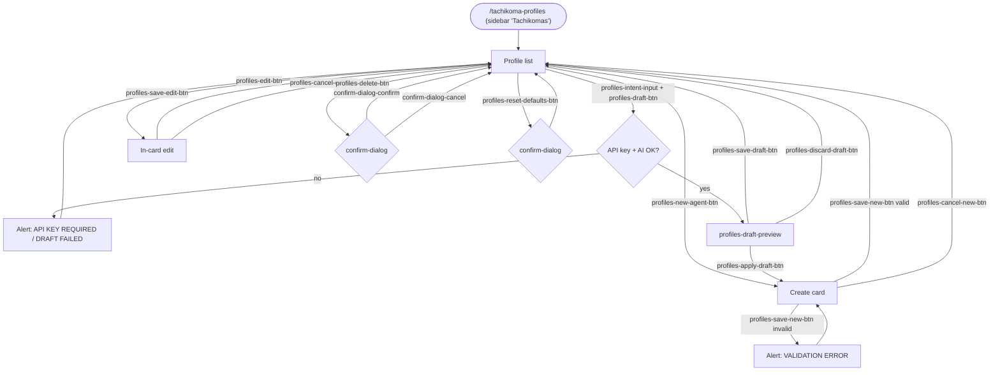

# Wireframe: Tachikoma Agent Profiles (As-Built)

| Field | Value |
| :--- | :--- |
| **Status** | As-built reference |
| **Version** | v1.1 (stabilisation: create/edit form ids final) |
| **Date** | 2026-11-24 (v1.0: 2026-11-23) |
| **Author** | Eunice (UI/UX Designer) |
| **Route** | `/tachikoma-profiles` (layout: `FullComponent`, public, no guard). Sidebar label "Tachikomas". |
| **PRD module** | AGNT |
| **Stories / shards** | AGNT-001, AGNT-002, AGNT-003, AGNT-004, AGNT-005 (Material confirm/alert dialogs) |
| **Source files** | `src/app/pages/tachikoma-profiles/tachikoma-profiles.component.{html,ts,scss}`, `src/app/components/confirm-dialog/confirm-dialog.component.ts` |
| **Related** | [Wireframe_Dialogs.md](Wireframe_Dialogs.md) (confirm / alert dialog) |

## 1. Screen Purpose

The user creates, drafts (with AI), edits, deletes or resets the agent personas used in chat. Success means the profile list reflects the change, saved to localStorage `tachikoma_agent_profiles` and synced to the cloud by the service.

## 2. Mobile Layout (primary)

One column of stacked `mat-card`s.

```
+---------------------------------------------+
| TACHIKOMA PROFILES                          |
| Configure AI personas for multi-agent ...   |
| [+ NEW AGENT] [restore RESET TO DEFAULTS]   |  profiles-new-agent-btn / profiles-reset-defaults-btn
+---------------------------------------------+
| DRAFT PERSONA FROM INTENT (card)            |  profiles-intent-draft-panel
| What kind of agent do you want?             |
| [_____________________________] n/500       |  profiles-intent-input
| +-- DRAFT RESULT — Review before saving --+ |  profiles-draft-preview (draftResult())
| | Name / Role / Model / Temp / Silence /  | |
| | System Prompt                           | |
| | [SAVE NOW] [EDIT FIRST] [x]             | |  profiles-save-draft-btn / -apply-draft-btn / -discard-draft-btn
| +-----------------------------------------+ |
| [ (psychology) GENERATE DRAFT ]             |  profiles-draft-btn (spinner + GENERATING...)
+---------------------------------------------+
| CREATE NEW AGENT (card, isAddingNew())      |
| Template [select v]                         |
| Agent Name [___]  Color Name [___]          |
| Hex Color [color]  Temperature (0-1) [0.5]  |
| Role [Chatter|Moderator v]  Model [v]       |
| Silence Protocol [v]                        |
| System Instruction Mode: [Form|XML|Plain]   |
|  FORM: Role, Personality[+], Instructions[+],
|        Constraints[+], Output Format, Tone, |
|        Sample Dialogue[+] (user/assistant)  |
|  XML:  <textarea rows=12>                   |
|  PLAIN:<textarea rows=8> [Convert to Form/XML]
| [SAVE] [CANCEL]                             |  profiles-save-new-btn / profiles-cancel-new-btn
+---------------------------------------------+
| PROFILE CARD (per profile)                  |
| [ LOGIKOMA ] Chatter (Random Order) Temp 0.2|  profiles-card-name (name badge)
| <system prompt preview>                     |
| [edit] [delete]                             |  profiles-edit-btn / profiles-delete-btn
|---------------------------------------------|
| (edit mode replaces view mode in-card)      |
| EDIT: LOGIKOMA  ...same fields as create... |
| [SAVE] [CANCEL]                             |  profiles-save-edit-btn / profiles-cancel-edit-btn
+---------------------------------------------+
```

## 3. Desktop Layout

The same card stack. `.form-grid` lays the create and edit fields out in multiple columns on wider screens, and `.full-width` fields (system mode, editors) span the row. Nothing appears or hides between breakpoints. The create card sits **above** the list; edit happens **in place** inside the profile card.

## 4. Component Inventory

| Component | Material or custom SCSS | Behaviour notes |
| :--- | :--- | :--- |
| Header actions | `mat-raised-button` (primary), `mat-stroked-button` (warn) | NEW AGENT is disabled while `isAddingNew()`. RESET asks for confirmation (Material confirm dialog: "RESET TO DEFAULTS"). |
| Intent draft card | `mat-card`, `mat-form-field` textarea (maxlength 500, `mat-hint` counter) | GENERATE DRAFT is disabled while `isDrafting() \|\| !intentText.trim()`. It needs an API key in localStorage, otherwise an alert dialog shows "API KEY REQUIRED". |
| Draft preview | Custom `.draft-preview` | SAVE NOW calls `saveDraftDirectly()` (adds a plaintext-mode profile). EDIT FIRST calls `applyDraft()` (opens the create form prefilled, plaintext mode). Discard clears it. |
| Create form | `mat-card` + `mat-form-field`, `mat-select`, `input type=color/number`, `mat-button-toggle-group` | The template select applies preset LOGIKOMA / GHOST-1 / MODERATOR / NEUTRAL. Model options: Gemma 4 26B/31B, Gemini Flash/Flash-Lite/Pro latest, 3.1 Pro preview, 3.1 Flash Lite, 3.5 Flash. Silence: standard / always_speak / conservative / agreeable. |
| System mode editors | `mat-button-toggle-group` (form / xml / plaintext) | Form mode compiles to XML on save (`AgentProfileModel.fieldsToXml`). Plaintext has "Convert to Form/XML" (AI), disabled when the text is empty or while converting. |
| Profile card | `mat-card` (`.profile-card`, `.editing`) | View mode shows the name badge (hex background), role label, temperature and system preview. |
| Edit form | Same controls as create, bound to `editingProfile()` | Starting an edit closes the create form. |
| Confirm / alert | `MatDialog` → `ConfirmDialogComponent` | Delete, Reset, validation errors, draft and convert results. See [Wireframe_Dialogs.md](Wireframe_Dialogs.md). |

## 5. Interaction & State Map

| Element | Default | Hover / focus | Active | Loading | Error / empty |
| :--- | :--- | :--- | :--- | :--- | :--- |
| `profiles-new-agent-btn` | Enabled | Raised hover | Opens the create card | n/a | Disabled while the create card is open |
| `profiles-reset-defaults-btn` | Enabled | Hover | Confirm dialog, then reset and reload | n/a | Cancel leaves everything unchanged |
| `profiles-intent-input` | Empty | Outline focus | Typing (≤ 500) | n/a | n/a |
| `profiles-draft-btn` | Disabled while empty | Hover | `draftFromIntent()` | Spinner + "GENERATING..." | Alerts: "INTENT REQUIRED", "API KEY REQUIRED", "DRAFT FAILED" |
| `profiles-draft-preview` | Hidden | n/a | Shown with the draft | n/a | n/a |
| `profiles-save-draft-btn` | In preview | Hover | Adds profile, clears preview | n/a | Silent no-op if the draft lacks a name or system prompt |
| `profiles-apply-draft-btn` | In preview | Hover | Opens the create form prefilled | n/a | n/a |
| `profiles-discard-draft-btn` | In preview | Tooltip | Clears preview and intent | n/a | n/a |
| `profiles-save-new-btn` | In create card | Hover | Validates, adds, closes | n/a | Alert "VALIDATION ERROR: Name and System Prompt are required." |
| `profiles-cancel-new-btn` | In create card | Hover | Closes | n/a | n/a |
| `profiles-edit-btn` | Per card | Tooltip | Card switches to edit mode | n/a | n/a |
| `profiles-delete-btn` | Per card | Tooltip | Confirm "DELETE AGENT PROFILE", then delete | n/a | Cancel keeps the profile |
| `profiles-save-edit-btn` | In edit mode | Hover | Validates, updates, exits edit | n/a | Validation alert |
| `profiles-cancel-edit-btn` | In edit mode | Hover | Exits edit | n/a | n/a |
| Convert to Form/XML (no id) | Plaintext mode | Tooltip | AI parse into form fields | Spinner + "Converting..." | Alerts "NOTHING TO CONVERT", "API KEY REQUIRED", "CONVERSION FAILED"; success shows "CONVERSION COMPLETE" |

## 6. UX Flow Diagram



## 7. data-test-id Map

Re-read from the final template state on 2026-11-23.

| Element | `data-test-id` | Condition |
| :--- | :--- | :--- |
| NEW AGENT button | `profiles-new-agent-btn` | Always. Disabled while `isAddingNew()`. |
| RESET TO DEFAULTS button | `profiles-reset-defaults-btn` | Always |
| Intent draft card | `profiles-intent-draft-panel` | Always |
| Intent textarea | `profiles-intent-input` | Always |
| Draft preview block | `profiles-draft-preview` | `*ngIf="draftResult()"` |
| SAVE NOW (draft) | `profiles-save-draft-btn` | In the draft preview |
| EDIT FIRST (draft) | `profiles-apply-draft-btn` | In the draft preview |
| Discard draft | `profiles-discard-draft-btn` | In the draft preview |
| GENERATE DRAFT | `profiles-draft-btn` | Always. Disabled while `isDrafting() \|\| !intentText.trim()`. |
| Create SAVE | `profiles-save-new-btn` | `*ngIf="isAddingNew()"` |
| Create CANCEL | `profiles-cancel-new-btn` | `*ngIf="isAddingNew()"` |
| Profile name badge | `profiles-card-name` | Per profile, view mode (`editingProfile()?.id !== profile.id`) |
| Edit (per card) | `profiles-edit-btn` | Per profile, view mode |
| Delete (per card) | `profiles-delete-btn` | Per profile, view mode |
| Edit SAVE | `profiles-save-edit-btn` | Edit mode for that card |
| Edit CANCEL | `profiles-cancel-edit-btn` | Edit mode for that card |

**Count: 16**

## Design Gaps

`{new|edit}` means two ids: one in the create card (`profiles-new-…`) and one in the in-card edit form (`profiles-edit-…`). All rows live in `pages/tachikoma-profiles/tachikoma-profiles.component.html`.

**Status key.** **Final** = frozen, to be implemented by Quinn as a test-id-only change (no behaviour or style change). **Proposed** = reserved, not yet scheduled.

| Element | Proposed `data-test-id` | Status | Placement |
| :--- | :--- | :--- | :--- |
| Profile card container (per profile) | `profiles-card` | Proposed | `mat-card.profile-card` |
| Template select (create only) | `profiles-new-template-select` | Final (to be implemented by Quinn as test-id-only change) | On the `mat-select` |
| Agent Name input | `profiles-{new\|edit}-name-input` | Final (to be implemented by Quinn as test-id-only change) | On the `input` |
| Color Name input | `profiles-{new\|edit}-color-input` | Final (to be implemented by Quinn as test-id-only change) | On the control |
| Hex Color input | `profiles-{new\|edit}-hex-input` | Final (to be implemented by Quinn as test-id-only change) | On the control |
| Temperature input | `profiles-{new\|edit}-temp-input` | Final (to be implemented by Quinn as test-id-only change) | On the control |
| Agent **Role select** (CHATTER / MODERATOR, `mat-select`, label "Role") | `profiles-{new\|edit}-role-select` | Final (to be implemented by Quinn as test-id-only change) | First "Role" field. On the `mat-select`. |
| Model select | `profiles-{new\|edit}-model-select` | Final (to be implemented by Quinn as test-id-only change) | On the `mat-select` |
| Silence Protocol select | `profiles-{new\|edit}-silence-select` | Final (to be implemented by Quinn as test-id-only change) | On the `mat-select` |
| System mode toggle group | `profiles-{new\|edit}-mode-toggle` | Final (to be implemented by Quinn as test-id-only change) | On the `mat-button-toggle-group` |
| System mode option: Form | `profiles-{new\|edit}-mode-form-btn` | Final (to be implemented by Quinn as test-id-only change) **New in v1.1** | On the `mat-button-toggle value="form"` |
| System mode option: XML | `profiles-{new\|edit}-mode-xml-btn` | Final (to be implemented by Quinn as test-id-only change) **New in v1.1** | On the `mat-button-toggle value="xml"` |
| System mode option: Plain Text | `profiles-{new\|edit}-mode-plaintext-btn` | Final (to be implemented by Quinn as test-id-only change) **New in v1.1** | On the `mat-button-toggle value="plaintext"` |
| Form mode: **system Role input** (identity text, `input`, label "Role", hint "Primary role and identity…") | `profiles-{new\|edit}-sys-role-input` | Final (to be implemented by Quinn as test-id-only change) | Second "Role" field, form mode only. On the `input`. |
| Form mode: add personality trait | `profiles-{new\|edit}-trait-add-btn` | Final (to be implemented by Quinn as test-id-only change) | On the control |
| Form mode: personality trait input (per row) | `profiles-{new\|edit}-trait-input` | Final (to be implemented by Quinn as test-id-only change) | On the control |
| Form mode: remove personality trait | `profiles-{new\|edit}-trait-remove-btn` | Final (to be implemented by Quinn as test-id-only change) | On the control |
| Form mode: add instruction | `profiles-{new\|edit}-instruction-add-btn` | Final (to be implemented by Quinn as test-id-only change) | On the control |
| Form mode: instruction input (per row) | `profiles-{new\|edit}-instruction-input` | Final (to be implemented by Quinn as test-id-only change) | On the control |
| Form mode: remove instruction | `profiles-{new\|edit}-instruction-remove-btn` | Final (to be implemented by Quinn as test-id-only change) | On the control |
| Form mode: add constraint | `profiles-{new\|edit}-constraint-add-btn` | Final (to be implemented by Quinn as test-id-only change) | On the control |
| Form mode: constraint input (per row) | `profiles-{new\|edit}-constraint-input` | Final (to be implemented by Quinn as test-id-only change) | On the control |
| Form mode: remove constraint | `profiles-{new\|edit}-constraint-remove-btn` | Final (to be implemented by Quinn as test-id-only change) | On the control |
| Form mode: output format input | `profiles-{new\|edit}-output-format-input` | Final (to be implemented by Quinn as test-id-only change) | On the control |
| Form mode: tone input | `profiles-{new\|edit}-tone-input` | Final (to be implemented by Quinn as test-id-only change) | On the control |
| Form mode: add sample dialogue | `profiles-{new\|edit}-dialogue-add-btn` | Final (to be implemented by Quinn as test-id-only change) | On the control |
| Form mode: remove sample dialogue | `profiles-{new\|edit}-dialogue-remove-btn` | Final (to be implemented by Quinn as test-id-only change) | On the control |
| Form mode: sample dialogue user textarea | `profiles-{new\|edit}-dialogue-user-input` | Final (to be implemented by Quinn as test-id-only change) | On the control |
| Form mode: sample dialogue assistant textarea | `profiles-{new\|edit}-dialogue-assistant-input` | Final (to be implemented by Quinn as test-id-only change) | On the control |
| XML mode **system-instruction textarea** (label "System Instruction (XML)", `.xml-editor`) | `profiles-{new\|edit}-xml-input` | Final (to be implemented by Quinn as test-id-only change) | On the `textarea` |
| Plain-text mode **system-instruction textarea** (label "System Prompt"; the default mode) | `profiles-{new\|edit}-plaintext-input` | Final (to be implemented by Quinn as test-id-only change) | On the `textarea` |
| Convert to Form/XML button | `profiles-{new\|edit}-convert-btn` | Final (to be implemented by Quinn as test-id-only change) | On the control |

That is 32 rows, or 63 concrete ids once `{new|edit}` is expanded. v1.1 added only the three per-option mode ids; every earlier name is unchanged.

**Disambiguation (AGNT T101, T114, triage T12).**
- The two fields labelled "Role" are distinct: `profiles-{new|edit}-role-select` is the agent's orchestration role (`mat-select`, always visible); `profiles-{new|edit}-sys-role-input` is the system-instruction identity text (`input`, form mode only). Tests must never match on the label.
- The system instruction is one of two textareas, depending on mode: `profiles-{new|edit}-plaintext-input` (default, `currentSystemMode = 'plaintext'`) or `profiles-{new|edit}-xml-input`. Select the mode with `profiles-{new|edit}-mode-{form|xml|plaintext}-btn` first if needed. The intent-draft textarea above the form already has `profiles-intent-input`; it is the reason a bare `textarea` selector matches the wrong element.
- Because the create card and edit form share one `currentSystemMode` signal (Observation 3), only one card shows the mode-specific fields at a time. The `new`/`edit` prefix still keeps the ids unique per card.

## As-Built Observations

1. On create, `temp: this.newProfile.temp || 0.5` turns a temperature of **0** into **0.5**.
2. Validation exempts form mode from the System Prompt check, so a form-mode agent can be saved with an empty compiled prompt.
3. The create card and the edit forms share one `currentSystemMode` signal and one `systemFields` object. Opening an edit after the create card replaces both.
4. (Deferred: Firebase AI Logic migration) Intent drafting and AI convert read the API key from localStorage (`gemini_api_key`). An authenticated user whose key is stored only on the profile could be told "API KEY REQUIRED". The code path is confirmed (`localStorage.getItem('gemini_api_key')`); whether it bites in practice depends on whether the key was ever saved locally on that device.
