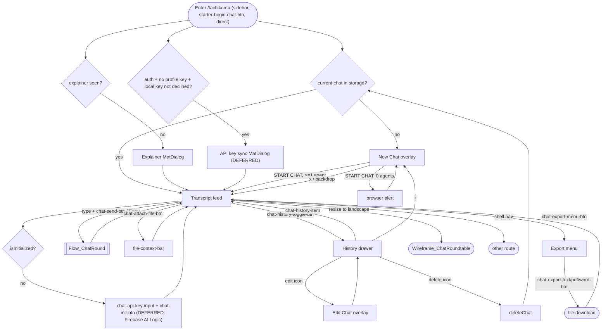

# Wireframe: Tachikoma Chat, Portrait / Mobile Transcript (As-Built)

| Field | Value |
| :--- | :--- |
| **Status** | As-built reference |
| **Version** | v1.1 (stabilisation: final ids, touch-reachable history actions (A6), API-key UI deferred) |
| **Date** | 2026-11-24 (v1.0: 2026-11-23) |
| **Author** | Eunice (UI/UX Designer) |
| **Route** | `/tachikoma` (layout: `FullComponent`, public, no guard) |
| **PRD modules** | CHAT (primary), ORCH, OPER, AUTH (API key) |
| **Stories / shards** | CHAT-001, CHAT-002, CHAT-003, CHAT-004 (shard only), ORCH-001..004, OPER-001, OPER-002, AUTH-002 |
| **Source files** | `src/app/pages/tachikoma-chat/tachikoma-chat.component.{html,ts,scss}`, `chat-explainer-dialog.component.ts`, `api-key-sync-dialog.component.ts` |
| **Companion** | [Wireframe_ChatRoundtable.md](Wireframe_ChatRoundtable.md) covers the **landscape** body and the **VS Code-style status bar**. The status bar renders in **both** orientations and is documented there. |
| **Flows** | [Flow_ChatRound.md](Flow_ChatRound.md) |
| **Scope note (v1.1)** | The app will move from the `@google/genai` bring-your-own-key model to **Firebase AI Logic**. Every API-key element on this screen (header key block, INIT button, API key sync dialog), with its gaps and observations, is marked 'Deferred: Firebase AI Logic migration'. These are documented as-built only. No fix is designed here, and the portrait header overlap (triage A3) is deferred with them. |

## 1. Screen Purpose

The user sends a prompt and reads the multi-agent transcript (chatters in shuffled order, then the moderator). They also manage chats (new, edit, switch, delete), attach shared file context and export. Success means the round's agent cards (or explicit failed-step cards) appear in the transcript and are saved to local storage.

## Orientation switch

`isLandscape = window.innerWidth >= 768 && window.innerWidth > window.innerHeight` (re-evaluated on `window:resize`).

- `@if (!isLandscape())`: **portrait body** (this document).
- `@else`: **landscape roundtable body** ([Wireframe_ChatRoundtable.md](Wireframe_ChatRoundtable.md)).

The header, the new/edit chat overlays, the history drawer and the status bar are **shared** by both orientations.

## 2. Mobile Layout (primary, portrait)

The page is rendered inside the app shell (see [Wireframe_Dashboard.md](Wireframe_Dashboard.md)).

```
+------------------------------------------------+
| HEADER (.chat-header)                          |
| [V4.4] TACHIKOMA PROTOCOL        [+] [hist] [dl]|  new chat / chat-history-toggle-btn / chat-export-menu-btn (*)
|        (o) SYNC MODE: SECURE-LINK              |  static text
| [Enter Gemini API Key______] [INIT]            |  chat-api-key-input / chat-init-btn  (only when !isInitialized; DEFERRED: Firebase AI Logic)
+------------------------------------------------+
| [!] Context approaching limit for <model> (NN%)|  chat-soft-limit-banner (contextSoftWarning)
+------------------------------------------------+
| CHAT FEED (.chat-feed, scrollable)        [^]  |  scroll-nav (fades in on scroll, 3s idle):
|  NEURAL LINK ESTABLISHED.                 [o3] |   chat-jump-top-btn / chat-jump-unread-btn (unread>0)
|  AGENTS: LOGIKOMA, GHOST-1, MODERATOR     [v]  |   / chat-jump-latest-btn
|  INITIATIVE IS RANDOMIZED PER QUERY.           |
|                                                |
|            +-------------------------------+   |
|            | USER // AUTHENTICATED         |   |  chat-user-message
|            | <prompt html>                 |   |
|            +-------------------------------+   |
|  +---------------------------------------+     |
|  | ◈ LOGIKOMA                            |     |  chat-agent-message (border = agent hex)
|  | <markdown html>                       |     |
|  +---------------------------------------+     |
|  +---------------------------------------+     |
|  | ⚠ GHOST-1 — STEP FAILED               |     |  chat-failed-step-card (failed-step | rate-limit)
|  | A processing error occurred...        |     |
|  | Attempts: 3                           |     |
|  +---------------------------------------+     |
|  +---------------------------------------+     |
|  | ⬢ MODERATOR                           |     |  chat-agent-message
|  +---------------------------------------+     |
|  (token) Round 0 · 12.3K tokens · ~$0.0012 (est.)| chat-round-cost-badge (one per finalized round, after ALL messages)
|  ...                                           |  processing typing dots (isProcessing)
+------------------------------------------------+
| (clip) SHARED CONTEXT (2 file(s))      [clear] |  file-context-bar (hasUploadedFiles) / chat-clear-files-btn
| [doc notes.md (x)] [doc data.csv (x)]          |  chat-remove-file-btn per chip
+------------------------------------------------+
| [clip] [Send packet to the net..........][SEND]|  chat-attach-file-btn / chat-message-input / chat-send-btn
+------------------------------------------------+
| SECURE-LINK | MODEL | ... TPM | CTX | RPM | ROUND n |  chat-status-bar -> see Wireframe_ChatRoundtable.md §Status Bar
+------------------------------------------------+
(*) export button only when messages.length > 0
```

**History drawer** (`mat-drawer`, `mode="over"`, `position="end"`, shared by both orientations):

```
                    +----------------------------+
                    | CHAT HISTORY        [+] [x]|  new chat / close (no ids)
                    |----------------------------|
                    | > Chat title     [edit][del]|  chat-history-item (.active = current)
                    |   11/23/26, 9:41 AM  12 msgs|  chat-history-item-title on the title span
                    | Chat title 2     [edit][del]|
                    |----------------------------|
                    | No saved chats yet         |  chat-history-empty (0 sessions)
                    +----------------------------+
```

**New Chat overlay** (custom fixed overlay, *not* `MatDialog`; opens on load when there is no current chat, and from the header or drawer `+`):

```
+------------------------------------------+
| SELECT PARTICIPATING AGENTS          [x] |  chat-new-chat-close-btn
| [Select All] [Clear All]                 |
| (T) CHAT TITLE (Optional)                |
| [______________________________] 0/100   |
| (D) CHAT CONTEXT / DESCRIPTION (Optional)|
| [______________________________] 0/500   |
| [x] LOGIKOMA        CHATTER       [#hex] |  agent-item (click toggles)
| [x] GHOST-1         CHATTER       [#hex] |
| [x] MODERATOR       MODERATOR     [#hex] |
| [x] NEUTRAL         CHATTER       [#hex] |
|   (empty: "No agents configured...")     |
|            [ START CHAT (4 selected) ]   |
+------------------------------------------+
```

**Edit Chat overlay** (same overlay style; opened by the drawer edit icon):

```
+------------------------------------------+
| EDIT CHAT DETAILS                    [x] |
| (T) CHAT TITLE  [________________] n/100 |
| (D) CHAT CONTEXT / DESCRIPTION (Optional)|
| [______________________________] n/500   |
|              [CANCEL] [SAVE CHANGES]     |
+------------------------------------------+
```

**Export menu** (custom absolute dropdown under the export button, `role="menu"`):

```
            +-----------------------------+
            | (doc) Export as Text (.txt) |  chat-export-text-btn
            | (pdf) Export as PDF (.pdf)  |  chat-export-pdf-btn
            | (doc) Export as Word (.docx)|  chat-export-word-btn
            +-----------------------------+
```

## 3. Desktop Layout

A **portrait** desktop window (taller than wide, at least 768px wide) keeps this layout. A **landscape** desktop window switches to the roundtable (see the companion wireframe). Portrait-specific desktop differences:

| Breakpoint | Change |
| :--- | :--- |
| `min-width: 768px` | The **NEURAL ACTIVITY status panel** (`.status-panel`, 16rem, right of the feed) becomes `display:block`. It renders only while `showNeuralActivity()` is true (during a round). It shows a PROCESSING/IDLE bar per agent and a "DEBUG STACK" packet log. |
| `max-width: 767px` | Many header and feed paddings and font sizes shrink (SCSS `@media (max-width: 767px)` blocks). |
| `max-width: 900px` | The header API key input narrows from 14rem to 10rem. |

The template comment says the header API key input is "tablet+ only", but no CSS hides it on mobile. It renders at every width while `!isInitialized`, and at 390px it overlaps the header buttons (triage A3). **Deferred: Firebase AI Logic migration**: the key block will be removed or redesigned, so no portrait header fix is designed now.

## 4. Component Inventory

| Component | Material or custom SCSS | Behaviour notes |
| :--- | :--- | :--- |
| Container | Custom `.tachikoma-container` + `.scanlines` overlay | A click anywhere calls `closeExportMenu()`. `landscape-grid-mode` class in landscape. |
| Header | Custom `.chat-header` | Static `V4.4` badge, glitch title, static "SYNC MODE: SECURE-LINK". |
| New chat button (header) | Custom `<button class="new-chat-btn">` + `matTooltip` | `showNewChatDialog()` selects all agents by default. |
| History toggle | `mat-icon-button` | `toggleHistoryDrawer()` |
| Export dropdown | Custom `.export-dropdown` / `.export-menu` (not `mat-menu`) | Rendered only when `messages.length > 0`. Each item downloads a file (FileSaver/jsPDF/docx) and closes the menu. |
| API key init (**Deferred: Firebase AI Logic migration.**) | Custom input + button | `*ngIf="!isInitialized"`, where `isInitialized = apiKey.length > 0`. **The input is two-way bound to `apiKey`**, so the block disappears after the first keystroke (see Observations). `saveKey()` writes localStorage (+ profile when authenticated), lists models and shows browser `alert('LINK ESTABLISHED. KEY SAVED.')`. |
| Soft-limit banner | Custom `.soft-limit-banner`, `role="alert"`, `aria-live="polite"` | Shown when any model's context is ≥ 80% (`SOFT_LIMIT_THRESHOLD`). |
| Transcript nav | `mat-mini-fab` x3 in `.scroll-nav` | Always in the DOM. `opacity:0; pointer-events:none` until a scroll or new agent message, then visible for 3s. |
| User bubble | Custom `.user-bubble` | Header is hard-coded "USER // AUTHENTICATED" (it ignores the guest state and the profile chat username). |
| Agent card | Custom `.agent-card` | Border and tint come from the agent hex. The icon glyph depends on agentId (◈ logikoma, ❖ ghost, ⬢ moderator, ● other). Content is `marked` HTML via `[innerHTML]`. |
| Failed-step card | Custom `.failed-step-card` (+ `.rate-limit-card`), `role="alert"` | Shows for `messageType` `failed-step` or `rate-limit`, with fixed copy per type and "Attempts: n". |
| Hard-limit notice | Message with `messageType: 'failed-step'`, sender `SYSTEM` | Renders through the **failed-step card template**, so it shows "SYSTEM — STEP FAILED / A processing error occurred..." and **not** the HARD LIMIT text stored in `msg.html` (see Observations). |
| Round cost badge | Custom `.round-cost-badge` | One per finalized round (`roundTokenEstimates`), rendered **after the whole message list**, not inline per round. `data-round` holds the 0-based round id. Session-only (not persisted). |
| Processing indicator | 3 `.typing-dot` | `*ngIf="isProcessing"`. |
| Neural activity panel | Custom `.status-panel` | See Desktop Layout. |
| File context bar | Custom chips + `mat-icon-button` | `*ngIf="hasUploadedFiles"`. Files are kept in memory only (`uploadedFiles` signal). |
| File input | Hidden `<input type="file" multiple>`, accept `.txt,.md,.json,.csv,.xml,.log,text/*` | Triggered by `chat-attach-file-btn`. Read errors trigger browser `alert`. |
| Message input + Send | Custom text input + button | Enter key or click calls `triggerProtocol()`. Ignored while `isProcessing` or when the input is blank. **The Send button is never disabled.** |
| History drawer | `mat-drawer-container` / `mat-drawer` (`over`, `end`) | `[opened]="historyDrawerOpened()"`. It closes after switching chats or creating a chat. Delete has **no confirmation**. |
| New / Edit chat overlays | Custom `.agent-selector-overlay` + `.agent-selector-dialog` (not `MatDialog`) | A backdrop click cancels. Zero agents selected on Start shows browser `alert('Please select at least one agent...')`. |
| Explainer dialog | `MatDialog` → `ChatExplainerDialogComponent` | First visit only (`tachikoma_chat_explainer_seen`). See [Wireframe_Dialogs.md](Wireframe_Dialogs.md). |
| API key sync dialog (**Deferred: Firebase AI Logic migration.**) | `MatDialog` → `ApiKeySyncDialogComponent` | When authenticated, the profile has no key and localStorage has a key not previously declined. See [Wireframe_Dialogs.md](Wireframe_Dialogs.md). |
| Status bar | Custom `.vscode-status-bar` | See [Wireframe_ChatRoundtable.md](Wireframe_ChatRoundtable.md). |

## 5. Interaction & State Map

| Element | Default | Hover / focus | Active | Loading | Error / empty |
| :--- | :--- | :--- | :--- | :--- | :--- |
| New chat (header) | Visible | Tooltip "New Chat" | Opens New Chat overlay | n/a | n/a |
| `chat-history-toggle-btn` | Visible | Tooltip | Toggles drawer | n/a | n/a |
| `chat-export-menu-btn` | Hidden until there is at least 1 message | Tooltip "Export Chat" | Toggles `.export-menu` | n/a | Hidden with 0 messages |
| `chat-export-{text,pdf,word}-btn` | In open menu | Item hover | Downloads file, closes menu | n/a | n/a |
| `chat-api-key-input` (**Deferred: Firebase AI Logic migration.**) | Shown when no key | Focus | Typing (block unmounts after first char) | n/a | n/a |
| `chat-init-btn` (**Deferred: Firebase AI Logic migration.**) | Shown when no key | Hover | `saveKey()` | Async model list (no spinner) | Empty key: `alert('INVALID KEY DETECTED')`. Profile sync failure: warning `alert`. |
| `chat-soft-limit-banner` | Hidden | n/a | n/a | n/a | Visible at ≥ 80% context |
| `chat-jump-top-btn` / `chat-jump-latest-btn` | Opacity 0, no pointer events | Tooltip | Scroll feed to top / bottom (latest also marks all read) | n/a | n/a |
| `chat-jump-unread-btn` | Only when `unreadCount() > 0` | Tooltip "n unread" | Advances `lastReadIndex` and scrolls to `[data-msg-index]` (**no element has that attribute, so no scroll occurs**) | n/a | Hidden at 0 unread |
| `chat-message-input` | Placeholder "Send packet to the net..." | Focus | Enter calls `triggerProtocol()` | Input cleared on send | Blank input does nothing. No key: `alert('PLEASE ENTER A VALID API KEY')`. |
| `chat-send-btn` | Enabled | Hover | `triggerProtocol()` | Stays enabled; re-entry ignored while `isProcessing` | As above |
| `chat-attach-file-btn` | `attach_file` icon | Tooltip | Opens file picker | Disabled, icon becomes spinning `sync` | Read error: `alert('Error reading file(s)...')` |
| `chat-clear-files-btn` | In file bar | Tooltip | Clears all files | n/a | Bar hidden with 0 files |
| `chat-remove-file-btn` | Per chip | Focus | Removes file at index | n/a | n/a |
| `chat-history-item` | `.active` if current | Row hover | `switchChat(id)` restores messages, agents and round; closes drawer | n/a | `chat-history-empty` with 0 sessions |
| `chat-history-edit-btn` / `chat-history-delete-btn` **as-built** | `opacity: 0` inside `.chat-actions` | Revealed only by `.chat-item:hover`; 20x20px hit area; `matTooltip` only (no `aria-label`) | Edit opens the Edit overlay; delete removes immediately, then `loadCurrentChat()` | n/a | Deleting the current chat with none left opens the New Chat overlay. **Unreachable on touch devices (A6).** |
| `chat-history-edit-btn` / `chat-history-delete-btn` **as-to-be (A6)** | Always visible on `hover: none` devices; hidden at rest on desktop | Desktop hover reveal unchanged; also revealed on keyboard focus (`:focus-within`) | Unchanged | n/a | Unchanged. Full contract in "History row actions: as-to-be (A6)" below. |
| New Chat overlay controls (`chat-new-chat-close-btn` shipped; `chat-new-chat-dialog`, `-title-input`, `-description-input`, `-agent-option`, `-start-btn` final, not yet in template) | All agents selected | n/a | Toggle agent, Select All / Clear All, START CHAT | n/a | 0 selected: browser alert. 0 agents configured: "No agents configured..." |
| Edit Chat overlay controls (no ids) | Prefilled | n/a | SAVE CHANGES (empty title keeps the old title) / CANCEL | n/a | n/a |

### History row actions: as-to-be (A6)

Triage A6: the edit and delete icons in each history row are `opacity: 0` until `.chat-item:hover` (`tachikoma-chat.component.scss`, `.chat-actions`). Touch users cannot reach them, and neither can the portrait Playwright project (Pixel 5, touch). Athena is landing a minimal SCSS fix in parallel, and this is the design contract that fix should meet. It changes visibility, hit area and labelling only. The click handlers, the icons and their order (edit, then delete) stay the same.

| # | Condition | Required behaviour |
| :--- | :--- | :--- |
| 1 | `@media (hover: none)` (touch-primary devices, including the portrait test project) | `.chat-actions` is **always visible** (`opacity: 1`) on every row, not only the active row. |
| 2 | Keyboard focus: `.chat-item:focus-within .chat-actions` | Actions become visible as soon as either button has focus, so Tab reaches them on any device. The focused button shows a visible focus ring: the global SAC baseline (`*:focus-visible` with `--sac-focus-ring` from `_sac-tokens.scss`) or a same-colour component override, which the baseline explicitly allows. No new colour. |
| 3 | `@media (hover: hover)` (desktop pointer) | **Unchanged**: hidden at rest, revealed by `.chat-item:hover` with the existing 0.2s opacity transition. |
| 4 | Hit area, all devices | Each button has a **minimum 44x44px touch target** (`min-width: 44px; min-height: 44px`). Keep the 16px `mat-icon` glyph centred and grow only the hit box. The row may grow to fit, and the title keeps its ellipsis. Leave at least 4px between the two targets so they do not overlap. |
| 5 | Accessible names | `chat-history-edit-btn`: `[attr.aria-label]="'Edit chat ' + session.title"`. `chat-history-delete-btn`: `[attr.aria-label]="'Delete chat ' + session.title"`. Keep the existing `matTooltip` ("Edit" / "Delete"). |
| 6 | Event isolation | Both buttons keep `$event.stopPropagation()`, so tapping an action never also fires `switchChat()` on the row. |
| 7 | Reduced motion | Under `prefers-reduced-motion: reduce`, the reveal has no transition. |

Out of scope for A6: a delete confirmation (Observation 7) and the delete colour. Both stay as-built.

**Status against Athena's in-progress SCSS fix (working tree, 2026-11-24):** rules 1, 2 and 3 are met (`@media (hover: none)` always shows the actions, `:focus-within` reveals them, the desktop hover reveal is kept, and the buttons get a `currentColor` `:focus-visible` outline). Rules 4 (44x44 hit area), 5 (`aria-label`s, a template change) and 7 (reduced motion) are still open. They are a follow-up and do not block the minimal fix or the T208–T210 unblock. Rule 5 can ship with Quinn's test-id change on the same two buttons only if the owner accepts an accessibility attribute in a test-id-only change; otherwise it goes to Athena.

Sketch, portrait drawer on a `hover: none` device:

```
+--------------------------------------------+
| Ops review 04              [edit] [del]    |  chat-history-item / chat-history-edit-btn / chat-history-delete-btn
| 11/24/26, 9:02 AM   12 msgs                |  each icon sits in a 44x44 target, always visible
+--------------------------------------------+
```

## 6. UX Flow Diagram



## 7. data-test-id Map

The ids below were re-read from the final template state on 2026-11-23. "Both" means the element renders in portrait and landscape. Landscape-only ids are listed in [Wireframe_ChatRoundtable.md](Wireframe_ChatRoundtable.md).

| Element | `data-test-id` | Condition |
| :--- | :--- | :--- |
| History drawer toggle (header) | `chat-history-toggle-btn` | Both, always |
| Export menu button | `chat-export-menu-btn` | Both, `*ngIf="messages.length > 0"` |
| Export as Text item | `chat-export-text-btn` | Both, `*ngIf="showExportMenu()"` |
| Export as PDF item | `chat-export-pdf-btn` | Both, `*ngIf="showExportMenu()"` |
| Export as Word item | `chat-export-word-btn` | Both, `*ngIf="showExportMenu()"` |
| Gemini API key input (**Deferred: Firebase AI Logic migration.**) | `chat-api-key-input` | Both, `*ngIf="!isInitialized"` |
| INIT button (**Deferred: Firebase AI Logic migration.**) | `chat-init-btn` | Both, `*ngIf="!isInitialized"` |
| Soft-limit banner | `chat-soft-limit-banner` | Portrait: above `main`. Landscape: below the file bar. `*ngIf="contextSoftWarning"`. **Two template instances; only one renders at a time.** |
| Jump to top | `chat-jump-top-btn` | Portrait only (`@if (!isLandscape())`). Always in the DOM but non-interactive until `scroll-nav-visible`. |
| Jump to unread | `chat-jump-unread-btn` | Portrait only, `*ngIf="unreadCount() > 0"` |
| Jump to latest | `chat-jump-latest-btn` | Portrait only, same visibility as jump-top |
| User message bubble | `chat-user-message` | Portrait only, per user message |
| Failed-step / rate-limit card | `chat-failed-step-card` | Portrait only, per message with `messageType` `failed-step` or `rate-limit` (includes the hard-limit notice) |
| Agent message card | `chat-agent-message` | Portrait: per normal agent message (`.agent-card`). **Also used in landscape** on the column content div. |
| Round cost badge | `chat-round-cost-badge` | Portrait only, one per round in `roundTokenEstimates`; attribute `data-round` = 0-based round id |
| Clear all files | `chat-clear-files-btn` | Both (separate instance per orientation), `*ngIf="hasUploadedFiles"` |
| Remove file (per chip) | `chat-remove-file-btn` | Both (separate instance per orientation), one per uploaded file |
| Attach file (portrait) | `chat-attach-file-btn` | Portrait only. Disabled while `isUploadingFile()`. |
| Message input | `chat-message-input` | Both (separate instance per orientation) |
| Send button | `chat-send-btn` | Both (separate instance per orientation) |
| History item row | `chat-history-item` | Both (drawer), one per session |
| History item title | `chat-history-item-title` | Both (drawer), one per session, on the title `<span>` |
| History empty state | `chat-history-empty` | Both (drawer), `*ngIf="getChatSessions().length === 0"` |
| New Chat overlay close (x) | `chat-new-chat-close-btn` | Both, `*ngIf="showAgentSelector()"` (added by Quinn during this pass) |
| Status bar | `chat-status-bar` | Both, always. Detailed in the companion wireframe. |

**Count: 25** (unique ids that render in portrait, including the shared header, drawer, New Chat overlay and status bar).

## Design Gaps

Interactive elements with no `data-test-id` (proposed ids, `[page]-[element]-[purpose]`). New Chat proposals reuse the `chat-new-chat-` prefix of the shipped `chat-new-chat-close-btn`, and Edit Chat mirrors it with `chat-edit-chat-`. All rows live in `tachikoma-chat.component.html`.

**Status key.** **Final** = frozen, to be implemented by Quinn as a test-id-only change (no behaviour or style change). **Proposed** = reserved, not yet scheduled. No v1.0 name was changed.

| Element | Proposed `data-test-id` | Status | Notes |
| :--- | :--- | :--- | :--- |
| Header New Chat button | `chat-header-new-chat-btn` | Proposed |  |
| Hidden file input (portrait, for `setInputFiles`) | `chat-file-input` | Proposed |  |
| Drawer New Chat button | `chat-history-new-btn` | Proposed |  |
| Drawer Close button | `chat-history-close-btn` | Proposed |  |
| History row edit icon (`button.edit-chat-btn`) | `chat-history-edit-btn` | Final (to be implemented by Quinn as test-id-only change) | CHAT T208. Pair with the A6 as-to-be contract. |
| History row delete icon (`button.delete-chat-btn`) | `chat-history-delete-btn` | Final (to be implemented by Quinn as test-id-only change) | CHAT T209, T210. Triage T9 suggested `chat-history-item-edit-btn` / `-delete-btn`; the names in this table are canonical. |
| New Chat overlay container (`.agent-selector-dialog` under `*ngIf="showAgentSelector()"`) | `chat-new-chat-dialog` | Final (to be implemented by Quinn as test-id-only change) | On the inner dialog `div`, not the backdrop. CHAT T201–T205 (`closeAutoOpenedNewChatSelector`). |
| New Chat "Select All" | `chat-new-chat-select-all-btn` | Proposed |  |
| New Chat "Clear All" | `chat-new-chat-clear-all-btn` | Proposed |  |
| New Chat title input (`name="new-chat-title-field"`) | `chat-new-chat-title-input` | Final (to be implemented by Quinn as test-id-only change) | CHAT T203 |
| New Chat description textarea (`name="new-chat-description-field"`) | `chat-new-chat-description-input` | Final (to be implemented by Quinn as test-id-only change) | CHAT T204, T205 |
| New Chat agent option row (`div.agent-item`, one per agent) | `chat-new-chat-agent-option` | Final (to be implemented by Quinn as test-id-only change) | Repeated per agent; selected state stays the `.selected` class. Tests filter by agent name text. |
| New Chat "No agents configured" empty state | `chat-new-chat-agents-empty` | Proposed |  |
| New Chat START CHAT button (`button.create-btn`) | `chat-new-chat-start-btn` | Final (to be implemented by Quinn as test-id-only change) | CHAT T202, T205 |
| Edit Chat overlay container | `chat-edit-chat-dialog` | Proposed |  |
| Edit Chat close (x) | `chat-edit-chat-close-btn` | Proposed |  |
| Edit Chat title input | `chat-edit-chat-title-input` | Proposed |  |
| Edit Chat description textarea | `chat-edit-chat-description-input` | Proposed |  |
| Edit Chat CANCEL | `chat-edit-chat-cancel-btn` | Proposed |  |
| Edit Chat SAVE CHANGES | `chat-edit-chat-save-btn` | Proposed |  |

Recommended non-interactive observability hooks:

| Element | Proposed `data-test-id` | Status | Notes |
| :--- | :--- | :--- | :--- |
| Processing typing indicator (portrait feed, `div.processing-indicator`, `*ngIf="isProcessing"`) | `chat-processing-indicator` | Final (to be implemented by Quinn as test-id-only change) | ORCH T300. Landscape: `chat-round-processing-indicator`. Status bar: `chat-status-processing` (both in [Wireframe_ChatRoundtable.md](Wireframe_ChatRoundtable.md)). |
| Neural activity panel (`div.status-panel`, `*ngIf="showNeuralActivity()"`) | `chat-neural-activity-panel` | Final (to be implemented by Quinn as test-id-only change) | `display: none` under 768px and absent in landscape, so neither test project sees it. Tests should assert `chat-status-processing` instead (triage T11); the id is for wide-portrait checks. |
| File context bar container | `chat-file-context-bar` | Proposed |  |
| File chip | `chat-file-chip` | Proposed |  |

The explainer gaps are listed in [Wireframe_Dialogs.md](Wireframe_Dialogs.md). The API key sync dialog gaps listed there, and the shipped `chat-api-key-input` / `chat-init-btn`, are **Deferred: Firebase AI Logic migration**. No new API-key ids are proposed.

## As-Built Observations (findings for owner / Jason; not resolved here)

1. **Deferred: Firebase AI Logic migration.** **The API key input unmounts after one keystroke.** `[(ngModel)]="apiKey"` writes the same field that `isInitialized` (`apiKey.length > 0`) reads, so `*ngIf="!isInitialized"` removes the input and INIT button after the first character. Playwright `fill()` sets the whole value at once, so tests may pass while real typing fails. Runtime confirmation is needed.
2. **The hard-limit notice copy is not shown.** `addHardLimitCard()` stores HARD LIMIT HTML, but the template renders failed-step cards from fixed copy, so the user sees "SYSTEM — STEP FAILED / A processing error occurred..." with no attempts line.
3. **The jump-to-unread button does not scroll.** It queries `[data-msg-index]`, which no template element sets.
4. **The round counter after reload.** `loadCurrentChat()` / `switchChat()` restore `currentRoundId = lastMessage.roundId`, while a live session leaves it at `lastRoundId + 1` after a round. After a reload, the next prompt reuses the last round id (see [Flow_ChatRound.md](Flow_ChatRound.md)).
5. The user bubble header is hard-coded "USER // AUTHENTICATED", even for guests and regardless of the profile chat username. The username is sent as `sender` but not displayed.
6. Browser `alert()` is still used on this screen (zero agents, key save, invalid key, file read error, API key profile-sync failure). AGNT-005 replaced browser dialogs only on the profiles page. The three key-related alerts are Deferred: Firebase AI Logic migration.
7. Deleting a chat in the drawer has no confirmation.
8. The intro copy lists "AGENTS: LOGIKOMA, GHOST-1, MODERATOR" statically, whatever agents participate.
