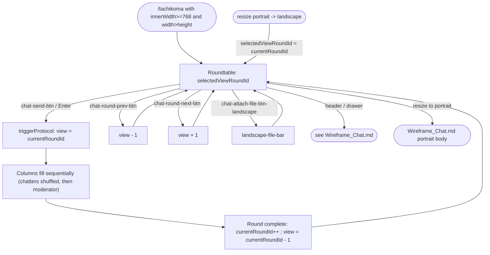

# Wireframe: Tachikoma Chat, Landscape Roundtable and VS Code-Style Status Bar (As-Built)

| Field | Value |
| :--- | :--- |
| **Status** | As-built reference. This supersedes [Landscape_Roundtable_Panel_Layout.md](Landscape_Roundtable_Panel_Layout.md) (v1.0, 2026-06-18) **as the description of shipped behaviour**. The spec file is retained unchanged, with an As-Built Deltas section appended. |
| **Version** | v1.1 (stabilisation: processing and status-bar metric ids final; API-key UI deferred) |
| **Date** | 2026-11-24 (v1.0: 2026-11-23) |
| **Author** | Eunice (UI/UX Designer) |
| **Route** | `/tachikoma` when `isLandscape()` is true (layout: `FullComponent`, public) |
| **PRD modules** | CHAT, ORCH (round display, silence), OPER (status bar metrics, soft limit) |
| **Stories / shards** | **No dedicated story or shard exists for the roundtable layout or the status bar.** The behaviour supports ORCH-001, ORCH-002, OPER-001 and OPER-002. Traceability gap flagged for Jason / Poe. |
| **Source files** | `src/app/pages/tachikoma-chat/tachikoma-chat.component.html` (`@else` branch and `.vscode-status-bar`), `.ts` (`isLandscape`, `selectedViewRoundId`, `prevRound/nextRound`, `getAgentMessageForRound`, `getUserPromptForRound`, `primaryModel`, `primaryModelMetrics`), `.scss` (`.top-input-bar`, `.round-nav-bar`, `.landscape-columns`, `.vscode-status-bar`) |
| **Companion** | [Wireframe_Chat.md](Wireframe_Chat.md) covers the shared header, history drawer, new/edit overlays and export menu. |

## 1. Screen Purpose

On a wide viewport the user reviews the discussion **one round at a time**: each participating agent gets a column, and the user can page back through earlier rounds. Success means the active round's columns fill with responses, SILENCE placeholders or failed-step HTML, and every earlier round can be browsed.

**Mode switch:** `isLandscape = innerWidth >= 768 && innerWidth > innerHeight`. On a resize into landscape, `selectedViewRoundId` jumps to `currentRoundId`.

## 2. Mobile Layout (primary)

Landscape requires a width of at least 768px, so **phones in landscape at under 768px CSS width stay in the portrait layout** ([Wireframe_Chat.md](Wireframe_Chat.md)). The smallest roundtable viewport is a tablet or large phone in landscape (≥ 768 × < 768). On such a viewport the `auto-fit, minmax(240px, 1fr)` grid fits about 3 columns per row, and a 4th agent wraps to a second row.

```
+-----------------------------------------------------------------------+
| HEADER (shared, see Wireframe_Chat.md)  [V4.4] TACHIKOMA PROTOCOL [+][h][dl]
+-----------------------------------------------------------------------+
| [clip] [Send initiating prompt to the roundtable.............] [SEND]  |  top-input-bar
+-----------------------------------------------------------------------+
| [<] ROUND 2 OF 3 [>] | PROMPT: "..."            ... PROCESSING        |  round-nav-bar
+-----------------------------------------------------------------------+
| ◈ LOGIKOMA  CHATTER  | ❖ GHOST-1  CHATTER   | ⬢ MODERATOR  MODERATOR  |  row 1
| <html>               | (-) SILENCE          | <html>                  |
|                      | No unique perspective|                         |
+-----------------------------------------------------------------------+
| ● NEUTRAL  CHATTER   |                                                |  row 2 (wrap)
| <html>               |                                                |
+-----------------------------------------------------------------------+
| (clip) SHARED CONTEXT (n file(s)) [clear] [chip (x)]                  |  landscape-file-bar
| [!] Context approaching limit ...                                     |  soft-limit banner (BELOW columns)
+-----------------------------------------------------------------------+
| SECURE-LINK | GEMINI-3.5-FLASH | PROCESSING    TPM | CTX | RPM | ROUND n|  chat-status-bar
+-----------------------------------------------------------------------+
```

## 3. Desktop Layout

On a wide desktop all agents sit in one row (each column ≥ 240px). With the default profiles the order is **LOGIKOMA, GHOST-1, MODERATOR, NEUTRAL**: columns follow `agents` (the participating agent order), so the moderator is **not** forced to the right.

```
+--------------------------------------------------------------------------------------------+
| [V4.4] TACHIKOMA PROTOCOL  (o) SYNC MODE: SECURE-LINK                 [+] [hist] [download] |
| [Enter Gemini API Key][INIT]   (only when !isInitialized; DEFERRED: Firebase AI Logic)      |
+--------------------------------------------------------------------------------------------+
| [clip] [ Send initiating prompt to the roundtable...                             ] [SEND]  |
+--------------------------------------------------------------------------------------------+
| [<]  ROUND 3 OF 4  [>]   PROMPT: "Compare SCSS and Tailwind..."          ... PROCESSING    |
+----------------------+----------------------+----------------------+-----------------------+
| ◈ LOGIKOMA  CHATTER  | ❖ GHOST-1  CHATTER   | ⬢ MODERATOR MODERATOR| ● NEUTRAL  CHATTER    |
|  [PROCESSING]        |                      | (moderator-col: left |                       |
|                      |                      |  border accent)      |                       |
| <markdown html>      | (-) SILENCE          | <markdown html>      | ...  (typing dots)    |
|                      | No unique perspective|                      |                       |
|                      | to append            |                      |                       |
+----------------------+----------------------+----------------------+-----------------------+
| SECURE-LINK | (bot) GEMINI-3.5-FLASH | (sync) PROCESSING      TPM: 12K/4M | CTX: 14% | RPM: 1/15 | ROUND 2 |
+--------------------------------------------------------------------------------------------+
```

### Column content resolution (per agent, for `selectedViewRoundId()`)

| Condition | Renders |
| :--- | :--- |
| A non-user message exists with `agentId === agent.id` and `roundId === selected` | `msg.html` in `.column-msg-content` (`data-test-id="chat-agent-message"`). **This includes failed-step / rate-limit messages**, whose stored HTML is a `.failed-step-card`. |
| No message, agent `thinking` and viewing the active round | Column typing dots (`.col-processing`) and a `PROCESSING` header badge |
| No message, and the round has a user prompt | **SILENCE** placeholder ("No unique perspective to append"). This shows for true silence **and** for agents that have not spoken yet. |
| No message and no prompt for this round | `—` (`.col-empty`) |

### Round navigation bar

| Part | Behaviour |
| :--- | :--- |
| `chat-round-prev-btn` | Disabled when `selectedViewRoundId() === 0`. Calls `prevRound()`. |
| `chat-round-indicator` | Text: `ROUND {{ selectedViewRoundId() + 1 }} OF {{ currentRoundId + 1 }}`. 1-based, and the total **includes the next, not-yet-started round**. |
| `chat-round-next-btn` | Disabled when `selectedViewRoundId() === currentRoundId`. After a completed round, `currentRoundId` has already been incremented, so Next can step onto the empty upcoming round ("No prompt yet — type above to begin."). |
| Prompt preview | `PROMPT: "<text>"`, or "No prompt yet — type above to begin." |
| Processing | Typing dots + `PROCESSING` when `isProcessing && selectedViewRoundId() === currentRoundId` |

## Status Bar (both orientations)

`div.vscode-status-bar` (`data-test-id="chat-status-bar"`) sits **outside** the drawer container, at the bottom of `.tachikoma-container`, so it renders in portrait and landscape. It is 24px tall with a VS Code blue background (`#007acc`).

| Segment | Side | Content | States |
| :--- | :--- | :--- | :--- |
| Sync | Left | Dot + **always** `SECURE-LINK` | `.status-warn` (amber `#fbbf24`) and `.dot-warn` when `contextSoftWarning` is non-null (any model ≥ 80% context). It does **not** reflect Firestore sync or online state. No tooltip. |
| Model | Left | `smart_toy` icon + `primaryModel`: the **first** model in use, `models/` stripped, upper-cased | No tooltip. Other models in use are not listed. |
| Processing | Left | `sync` spinning icon + `PROCESSING` | `*ngIf="isProcessing"` |
| TPM | Right | `TPM: used/limit` | Rendered only when `primaryModelMetrics` exists. Warn above 80%, danger above 95% (danger pulses via `meterPulse`). Tooltip "Tokens per minute". |
| CTX | Right | `CTX: n%` (`conversationContextTokens / inputTokenLimit`) | Same guard and thresholds. Tooltip "Context window usage". |
| RPM | Right | `RPM: requestTimestamps.length / maxRequestsPerMinute` (profile `rateLimitRPM`, default 15) | Warn above 80%, danger above 95%. Tooltip "Requests per minute". |
| Round | Right | `ROUND {{ currentRoundId }}`: **0-based active round id** (equals the number of completed rounds in a live session) | Tooltip "Active conversation round". **Off by one against the nav indicator** (see Observations). |

Metrics reflect the **first** model only; per-model breakdowns are not shown.

## 4. Component Inventory

| Component | Material or custom SCSS | Behaviour notes |
| :--- | :--- | :--- |
| Top input bar | Custom `.top-input-bar` + hidden file input `#fileInputLandscape` | Placeholder "Send initiating prompt to the roundtable...". Enter or SEND calls `triggerProtocol()`. |
| Attach (landscape) | `mat-icon-button` + `matTooltip` | Own id `chat-attach-file-btn-landscape` |
| Round nav arrows | Native `<button class="nav-arrow">` + `mat-icon` | Native `disabled` |
| Agent columns | Custom CSS grid `.landscape-columns { grid-template-columns: repeat(auto-fit, minmax(240px, 1fr)) }` | Border `agent.hex + '66'`, header tint `agent.hex + '1A'`. `.moderator-col` adds a left border accent. |
| SILENCE placeholder | Custom `.silence-placeholder` + `remove_circle_outline` | See the resolution table |
| File bar | Same as portrait (`.landscape-file-bar`) | Below the columns |
| Soft-limit banner | Same as portrait | **Below** the columns and file bar (portrait puts it above the feed) |
| Status bar | Custom `.vscode-status-bar` | See above |
| Not present in landscape | n/a | User bubbles, failed-step card template, round cost badges, transcript nav (jump buttons), neural activity panel and the feed typing indicator are portrait-only. **Hard-limit notices (no `agentId`) never render in landscape.** |

## 5. Interaction & State Map

| Element | Default | Hover / focus | Active | Loading | Error / empty |
| :--- | :--- | :--- | :--- | :--- | :--- |
| `chat-message-input` (landscape) | Empty | Focus | Enter calls `triggerProtocol()`; view jumps to the active round | Cleared | Same alerts as portrait |
| `chat-send-btn` (landscape) | Enabled | Hover | `triggerProtocol()` | Not disabled; re-entry ignored | n/a |
| `chat-attach-file-btn-landscape` | Icon | Tooltip | File picker | Disabled + spinner | `alert` on read error |
| `chat-round-prev-btn` | Disabled on round 0 | Tooltip | `selectedViewRoundId - 1` | n/a | n/a |
| `chat-round-next-btn` | Disabled at `currentRoundId` | Tooltip | `selectedViewRoundId + 1` | n/a | n/a |
| `chat-round-indicator` | `ROUND 1 OF 1` on a fresh chat | n/a | Updates on nav or send | n/a | n/a |
| Column | `—` before any prompt | n/a | Shows HTML | PROCESSING badge + dots | SILENCE placeholder; failed-step HTML |
| `chat-status-bar` segments | Muted | Tooltip (TPM/CTX/RPM/ROUND only) | n/a | PROCESSING segment | Warn/danger colours; sync segment turns amber at the soft limit |

## 6. UX Flow Diagram



## 7. data-test-id Map

Re-read from the final template state on 2026-11-23.

| Element | `data-test-id` | Condition |
| :--- | :--- | :--- |
| Attach file (landscape) | `chat-attach-file-btn-landscape` | Landscape only (`@else` of `@if (!isLandscape())`). Disabled while `isUploadingFile()`. |
| Message input (top bar) | `chat-message-input` | Landscape instance (portrait has its own) |
| Send button (top bar) | `chat-send-btn` | Landscape instance (portrait has its own) |
| Previous round | `chat-round-prev-btn` | Landscape only. Disabled at round 0. |
| Round indicator | `chat-round-indicator` | Landscape only |
| Next round | `chat-round-next-btn` | Landscape only. Disabled at `currentRoundId`. |
| Agent column message content | `chat-agent-message` | Landscape: per column when a message exists for the viewed round (same id as the portrait `.agent-card`) |
| Clear all files | `chat-clear-files-btn` | Landscape instance, `*ngIf="hasUploadedFiles"` |
| Remove file | `chat-remove-file-btn` | Landscape instance, per file |
| Soft-limit banner | `chat-soft-limit-banner` | Landscape instance, `*ngIf="contextSoftWarning"` |
| Status bar | `chat-status-bar` | **Both orientations**, always |

**Count: 11** (landscape body + status bar). The shared header and drawer ids (`chat-history-toggle-btn`, `chat-export-*`, `chat-api-key-input` and `chat-init-btn` (both Deferred: Firebase AI Logic migration), `chat-history-item`, `chat-history-item-title`, `chat-history-empty`) also render in landscape; see [Wireframe_Chat.md](Wireframe_Chat.md).

## Design Gaps

**Status key.** **Final** = frozen, to be implemented by Quinn as a test-id-only change (no behaviour or style change). **Proposed** = reserved, not yet scheduled. No v1.0 name was changed. All rows live in `tachikoma-chat.component.html`.

| Element | Proposed `data-test-id` | Status | Notes |
| :--- | :--- | :--- | :--- |
| Hidden file input (landscape, for `setInputFiles`) | `chat-file-input-landscape` | Proposed |  |
| Agent column container | `chat-round-agent-column` (+ `[attr.data-agent-id]`) | Proposed |  |
| Column PROCESSING header badge | `chat-round-column-processing` | Proposed |  |
| SILENCE placeholder | `chat-round-silence-placeholder` | Proposed |  |
| Empty column (`—`) | `chat-round-column-empty` | Proposed |  |
| Round prompt preview | `chat-round-prompt-preview` | Proposed |  |
| Round-level processing indicator (`div.round-processing`) | `chat-round-processing-indicator` | Final (to be implemented by Quinn as test-id-only change) | Landscape counterpart of `chat-processing-indicator` |
| Status bar sync segment | `chat-status-sync` | Proposed |  |
| Status bar model segment | `chat-status-model` | Final (to be implemented by Quinn as test-id-only change) | OPER T500, T501 (triage T6) |
| Status bar processing segment (`span.status-processing`) | `chat-status-processing` | Final (to be implemented by Quinn as test-id-only change) | ORCH T300 (triage T11), both orientations |
| Status bar TPM segment | `chat-status-tpm` | Final (to be implemented by Quinn as test-id-only change) | OPER T500, T504, T506, T510 (triage T6) |
| Status bar CTX segment | `chat-status-ctx` | Final (to be implemented by Quinn as test-id-only change) | OPER T509, T510 (triage T6) |
| Status bar RPM segment | `chat-status-rpm` | Final (to be implemented by Quinn as test-id-only change) | OPER T511 (triage T6) |
| Status bar ROUND segment | `chat-status-round` | Proposed |  |

The status-bar metric segments were promoted to Final because triage T6 re-points seven OPER tests at them. The test-to-segment mapping above is indicative; Quinn owns the final assertions.

These are non-interactive observability hooks, except the file input. They are needed to assert the deltas below in E2E.

## As-Built Observations (findings for owner / Jason; not resolved here)

1. **Round label mismatch.** On a fresh chat during the first round, the nav shows `ROUND 1 OF 1` and the status bar shows `ROUND 0`. After the first round completes, the nav shows `ROUND 1 OF 2` (viewing the completed round) and the status bar shows `ROUND 1`. The status bar is 0-based, or a completed-round count, while the nav is 1-based and counts the upcoming round.
2. **SILENCE placeholder ambiguity.** An agent that has not spoken yet (queued behind the current speaker) shows "SILENCE" until its turn, because only `thinking` agents get dots.
3. **Hard-limit notices are invisible in landscape**, because they carry no `agentId`.
4. **Phones in landscape** (CSS width under 768) never see the roundtable.
5. Spec-vs-code differences are recorded in [Landscape_Roundtable_Panel_Layout.md § As-Built Deltas](Landscape_Roundtable_Panel_Layout.md#as-built-deltas).
