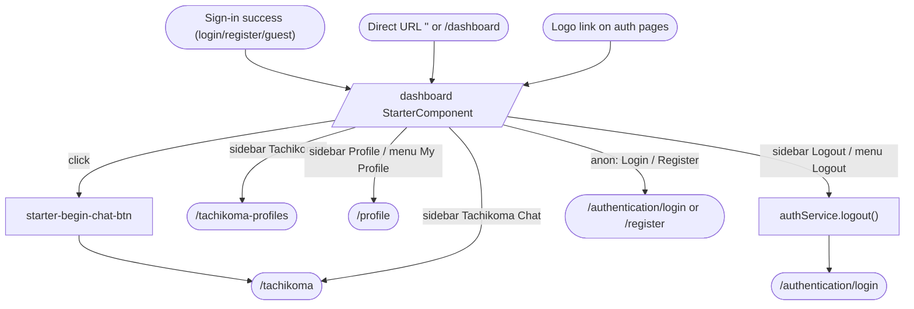

# Wireframe: Dashboard / Starter and App Shell (As-Built)

| Field | Value |
| :--- | :--- |
| **Status** | As-built reference |
| **Version** | v1.0 |
| **Date** | 2026-11-23 |
| **Author** | Eunice (UI/UX Designer) |
| **Route** | `/dashboard` (and `''`, which redirects to it). Layout: `FullComponent`, public (no route guard). |
| **PRD module** | Cross-cutting entry point (CHAT entry CTA); shell also serves AUTH (login/logout nav) |
| **Stories / shards** | None specific. The shell reflects OPER-004 (shell alignment) and AUTH-001 (auth-aware nav). |
| **Source files** | `src/app/pages/starter/starter.component.{html,ts}`, `src/app/layouts/full/full.component.{html,ts}`, `layouts/full/header/header.component.html`, `layouts/full/sidebar/sidebar.component.html`, `layouts/full/sidebar/nav-item/nav-item.component.html`, `layouts/full/sidebar/sidebar-data.ts` |

## 1. Screen Purpose

The user lands here after sign-in (or straight away, since there is no guard), reads what the product does and goes to the chat. Success means clicking **Start Multi-Agent Chat**, which opens `/tachikoma`.

The **app shell** (sidebar, top toolbar, profile menu) wraps every `FullComponent` route: `/dashboard`, `/tachikoma`, `/tachikoma-profiles` and `/profile`. It is documented here once and referenced from the other wireframes.

## 2. Mobile Layout (primary)

`MOBILE_VIEW = (max-width: 768px)`. The sidebar is `mode="over"` and closed by default; the hamburger opens it.

```
+---------------------------------------+
| [=]                            (avatar)|  app-header toolbar: hamburger / profile menu
+---------------------------------------+
| WELCOME CARD                          |
|  Welcome to SAC Console               |
|  Multi-Agent AI Chat System           |
|  <blurb>                              |
|  [ Start Multi-Agent Chat ]  (v) Ready|  starter-begin-chat-btn
|---------------------------------------|
| WHAT YOU CAN DO (4 features, stacked) |
|  Multi-Agent / Customizable / Gemini /|
|  Export                               |
|---------------------------------------|
| AGENT CARD: Logikoma (temp 0.2)       |
| AGENT CARD: Ghost-1  (temp 0.7)       |
| AGENT CARD: Moderator (temp 0.5)      |
|---------------------------------------|
| GETTING STARTED 1..4 (stacked)        |
+---------------------------------------+

Sidebar (overlay when opened):
+-------------------+
| [branding]    [x] |
| HOME              |
|  Dashboard        |
|  Tachikoma Chat   |
|  Tachikomas       |
| ACCOUNT (auth)    |  <- authenticated: Profile, Logout
|  Profile          |
|  Logout           |
| AUTH (anon)       |  <- not authenticated: Login, Register
|  Login / Register |
+-------------------+
```

## 3. Desktop Layout

Above 1024px the sidebar is `mode="side"` and permanently open. Between 769 and 1024px (`TABLET_VIEW`) the sidebar collapses.

```
+------------+---------------------------------------------------------+
| branding   | [=]                                            (avatar) |
| HOME       +---------------------------------------------------------+
|  Dashboard | WELCOME CARD (col-sm-8 text | col-sm-4 hexagon icon)    |
|  Chat      +---------------------------------------------------------+
|  Tachikomas| WHAT YOU CAN DO: 4 columns (col-lg-3 each)               |
| ACCOUNT    +-------------------+-------------------+-----------------+
|  Profile   | Logikoma          | Ghost-1           | Moderator       |
|  Logout    +-------------------+-------------------+-----------------+
|            | GETTING STARTED 2x2 (col-md-6)                          |
+------------+---------------------------------------------------------+
```

## 4. Component Inventory

| Component | Material or custom SCSS | Behaviour notes |
| :--- | :--- | :--- |
| Shell container | `mat-sidenav-container` / `mat-sidenav` / `mat-sidenav-content` | `isOver` toggles `over` / `side` mode via `BreakpointObserver`. |
| Sidebar nav | `mat-nav-list` + `app-nav-item` (`a mat-list-item`) | Items come from `dynamicNavItems()`: Home group always shown; then Account + Logout when authenticated, or Auth (Login, Register) otherwise. Logout is a click handler (`isLogout`) that calls `authService.logout()` and then navigates to `/authentication/login`. |
| Sidebar close | `<a>` with Tabler `x` | Shown only when `showToggle` (overlay mode). |
| Top toolbar | `mat-toolbar` | Hamburger `mat-icon-button` toggles the sidenav. |
| Profile menu | `mat-mini-fab` + `mat-menu` | Authenticated: name/email header, **My Profile** (goes to `/profile`), **Logout**. Anonymous: **Login**, **Register**. Shows `userPhotoURL()` or a user icon. |
| Welcome card | `mat-card` | Static copy. The CTA is a `mat-flat-button` primary that calls `navigateToProtocol()` and routes to `/tachikoma`. |
| Feature / agent / getting-started cards | `mat-card`, Tabler icons, utility classes | Static and non-interactive. The agent cards are **hard-coded** (Logikoma, Ghost-1, Moderator). They do not reflect the user's configured agents, and NEUTRAL is not shown. |

## 5. Interaction & State Map

| Element | Default | Hover / focus | Active | Loading | Error / empty |
| :--- | :--- | :--- | :--- | :--- | :--- |
| `starter-begin-chat-btn` | Enabled | Flat hover | Navigates to `/tachikoma` | n/a | n/a |
| Hamburger (no id) | Visible | Icon hover | Toggles sidenav | n/a | n/a |
| Profile FAB (no id) | Avatar or icon | FAB hover | Opens `mat-menu` | n/a | n/a |
| Sidebar nav item (no id) | `activeMenu` class when the route is active | List hover | Navigates; in overlay mode also closes the sidenav | n/a | n/a |
| Logout (sidebar or menu, no id) | Shown when authenticated | Hover | Clears local data, signs out, then `/authentication/login` | n/a | Header: errors logged only |

"System Ready" next to the CTA is static text and does not reflect real state.

## 6. UX Flow Diagram



## 7. data-test-id Map

| Element | `data-test-id` | Condition |
| :--- | :--- | :--- |
| Start Multi-Agent Chat button | `starter-begin-chat-btn` | Always |

**Count: 1** (the starter page). The shell has **0** ids today; see Design Gaps.

## Design Gaps

| Screen | Element | Proposed `data-test-id` |
| :--- | :--- | :--- |
| Shell header | Hamburger (toggle sidenav) | `shell-header-menu-btn` |
| Shell header | Profile avatar FAB (menu trigger) | `shell-header-profile-btn` |
| Shell profile menu | My Profile item | `shell-profile-menu-profile-btn` |
| Shell profile menu | Logout button | `shell-profile-menu-logout-btn` |
| Shell profile menu | Login item (anonymous) | `shell-profile-menu-login-btn` |
| Shell profile menu | Register item (anonymous) | `shell-profile-menu-register-btn` |
| Shell sidebar | Close (x) link in overlay mode | `shell-sidebar-close-btn` |
| Shell sidebar | Dashboard nav item | `shell-nav-dashboard-link` |
| Shell sidebar | Tachikoma Chat nav item | `shell-nav-chat-link` |
| Shell sidebar | Tachikomas nav item | `shell-nav-profiles-link` |
| Shell sidebar | Profile nav item | `shell-nav-profile-link` |
| Shell sidebar | Logout nav item | `shell-nav-logout-btn` |
| Shell sidebar | Login nav item | `shell-nav-login-link` |
| Shell sidebar | Register nav item | `shell-nav-register-link` |

Implementation hint for athena: `nav-item` is data-driven, so the cleanest fix is a `testId` field on `NavItem` in `sidebar-data.ts`, bound as `[attr.data-test-id]="item.testId"`.

## Not Part of the Product (Not Wireframed)

These are template leftovers. No product route renders them: `app.routes.ts` and `pages.routes.ts` never import `extra.routes.ts` or `ui-components.routes.ts`, and the starter page uses none of the widgets.

| Path | Kind |
| :--- | :--- |
| `src/app/components/apps-blog/` | Template widget |
| `src/app/components/daily-activities/` | Template widget |
| `src/app/components/product-performance/` | Template widget |
| `src/app/components/sales-overview/` | Template widget |
| `src/app/pages/ui-components/**` (badge, chips, forms, lists, menu, tables, tooltips) | Template demo pages, unrouted |
| `src/app/pages/extra/**` (icons, sample-page) | Template demo pages, unrouted |
| `src/app/layouts/full/top-strip/` | WrapPixel promo strip, not referenced by `full.component.html` |

## As-Built Observations

1. There are no route guards. `/dashboard`, `/tachikoma`, `/tachikoma-profiles` and `/profile` are reachable without signing in.
2. The wildcard route `**` redirects to `authentication/error`, but `AuthenticationRoutes` defines only `login` and `register`. Whether this produces a navigation error or a blank `BlankComponent` could not be determined from code alone.
3. The dashboard agent cards are static. They advertise "Gemini 2.0 Flash Exp" and "PDF or Word" export, while the shipped models are Gemini 3.x and Gemma 4, and export also offers `.txt`. The copy is stale.
