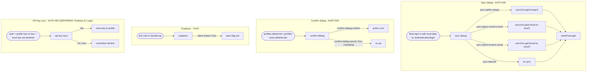

# Wireframe: Dialogs and Overlays (As-Built)

| Field | Value |
| :--- | :--- |
| **Status** | As-built reference |
| **Version** | v1.1 (stabilisation: API key sync dialog deferred) |
| **Date** | 2026-11-24 (v1.0: 2026-11-23) |
| **Author** | Eunice (UI/UX Designer) |
| **Routes** | Opened over `/dashboard` (sync dialog, after sign-in on `/authentication/login`), `/tachikoma` (explainer, API key sync), `/tachikoma-profiles` (confirm / alert) |
| **PRD modules** | AUTH (sync dialog, API key sync), AGNT (confirm / alert), CHAT (explainer) |
| **Stories / shards** | AUTH-003, AUTH-002, AGNT-005, CHAT-001 |
| **Source files** | `src/app/components/sync-dialog/sync-dialog.component.ts`, `src/app/components/confirm-dialog/confirm-dialog.component.ts`, `src/app/pages/tachikoma-chat/chat-explainer-dialog.component.ts`, `src/app/pages/tachikoma-chat/api-key-sync-dialog.component.ts` (all inline templates) |

The chat's **New Chat** and **Edit Chat** overlays are custom fixed overlays, not `MatDialog`. They are documented in [Wireframe_Chat.md](Wireframe_Chat.md).

## 1. Screen Purpose

| Dialog | Purpose / success |
| :--- | :--- |
| **Sync dialog** (`SyncDialogComponent`) | On a real sign-in with local data present, the user picks how local and cloud data reconcile: merge, cloud, local, or skip. Success means the dialog closes with a strategy and `FirestoreService.syncOnLogin(strategy)` completes. |
| **Confirm / alert** (`ConfirmDialogComponent`) | Confirm destructive actions (delete agent, reset defaults) or acknowledge a notice (validation, draft and convert results). Success means `true` or `false` is returned to the caller. |
| **Chat explainer** (`ChatExplainerDialogComponent`) | First-visit onboarding for the chat. Success means it is dismissed and `tachikoma_chat_explainer_seen` is set. |
| **API key sync** (`ApiKeySyncDialogComponent`) | Offer to copy a localStorage Gemini key to the user profile. Success means the key is saved to the profile (accept), or the decline is remembered for that key. |

## 2. Mobile Layout (primary)

All four use `maxWidth: '90vw'`.

**Sync dialog** (`width: 650px`, `disableClose: true`, `panelClass: 'sync-dialog-container'`). Below 768px the three options stack in one column:

```
+------------------------------------------+
| (cloud_sync) Sync Your Data              |
| You have local data on this device. How  |
| would you like to sync with the cloud?   |
| +--------------------------------------+ |
| | (merge) Merge Data                   | |  sync-option-merge
| | Combine local and cloud data...      | |
| | [RECOMMENDED]                        | |
| +--------------------------------------+ |
| | (cloud_download) Use Cloud Data      | |  sync-option-cloud-to-local
| | Replace local data with cloud...     | |
| +--------------------------------------+ |
| | (cloud_upload) Use Local Data        | |  sync-option-local-to-cloud
| | Upload local data to cloud...        | |
| +--------------------------------------+ |
| (i) This includes chat history, agent    |
|     profiles, and settings.              |
|------------------------------------------|
|           [ Skip for Now ]               |  sync-skip-btn
+------------------------------------------+
```

**Confirm / alert** (`width: 420px`; `alertOnly` hides Cancel):

```
+-----------------------------------+
| DELETE AGENT PROFILE              |  data.title
| Delete this agent profile? This   |  data.message
| action cannot be undone.          |
|              [CANCEL] [DELETE]    |  confirm-dialog-cancel / confirm-dialog-confirm
+-----------------------------------+
alertOnly:   [ OK ]                    confirm-dialog-confirm
```

**Chat explainer** (`width: 600px`, closable by backdrop or Esc):

```
+------------------------------------------+
| (chatbot) Welcome to Multi-Agent Chat    |
| <lead text>                              |
| (gear) How It Works                      |
|  1 You Ask a Question                    |
|  2 Agents Respond in Sequence            |
|    [Logikoma] [Ghost-1] [Moderator]      |
|  3 Get Comprehensive Answers (SILENCE)   |
| (stars) Key Features (2x2 grid)          |
| (bulb) Pro Tip: Enter your Gemini API key|
|        in settings (top right)...        |
|   [Don't show again] [Got it, let's start!]
+------------------------------------------+
```

**API key sync** (`width: 500px`, closable by backdrop or Esc). **Deferred: Firebase AI Logic migration**: documented as-built only; it will be removed or redesigned with the move to Firebase AI Logic.

```
+------------------------------------------+
| Save API Key to Profile?                 |
| We found a Gemini API key in your        |
| browser's local storage.                 |
| Would you like to save it to your user   |
| profile so it's available across ...     |
| | Note: This will securely sync ...      |
|------------------------------------------|
|   [No, Keep Local Only] [Yes, Save to Profile]
+------------------------------------------+
```

## 3. Desktop Layout

- **Sync dialog**: the three option cards sit side by side (`grid-template-columns: repeat(3, 1fr)`) at 768px and up.
- **Explainer**: the feature grid is 2 columns on desktop and 1 on small screens.
- **Confirm** and **API key sync**: no structural change.

## 4. Component Inventory

| Dialog / element | Material or custom SCSS | Behaviour notes |
| :--- | :--- | :--- |
| Sync dialog shell | `MatDialog`, `mat-dialog-title/content/actions` | `disableClose: true`, so only an option or Skip closes it. Inline styles use hard-coded neon hex values, not `_sac-tokens.scss` tokens. |
| Sync option cards | **Custom `div.option-card` with `(click)`** | No `role="button"`, no `tabindex`, no key handler, so **keyboard users cannot pick an option**. Only Skip is focusable. |
| Sync Skip | `mat-stroked-button` | Closes with `'cancel'`. |
| Confirm dialog | `MatDialog`, `mat-stroked-button` (cancel, `cdkFocusInitial`), `mat-raised-button` (confirm, colour from data) | Uses `[mat-dialog-close]`. Labels default to `CANCEL` / `CONFIRM`, or `OK` when alert-only. `autoFocus` is `'dialog'` for alerts and `'first-tabbable'` for confirms. `restoreFocus: true`. |
| Explainer | `MatDialog`, `mat-button`, `mat-flat-button` | **Both buttons call the same `close()`**. "Don't show again" and "Got it" behave identically, and the seen flag is set on any close. The tip mentions "settings (top right)", but the key input actually lives in the chat header. |
| API key sync | `MatDialog`, `mat-button`, `mat-raised-button` | Accept saves the key to the profile (on failure, browser `alert`). Decline stores `api_key_sync_declined = <key>`. Opens 1s after the auth effect fires. |

**Browser-native dialogs still in use (not Material):** these `window.alert` calls in `tachikoma-chat.component.ts` have no `data-test-id` and need Playwright `page.on('dialog')`:

| Trigger | Message |
| :--- | :--- |
| START CHAT with 0 agents | "Please select at least one agent to participate in the chat." |
| INIT with an empty key | "INVALID KEY DETECTED" |
| INIT success | "LINK ESTABLISHED. KEY SAVED." |
| INIT when profile sync fails | "WARNING: KEY SAVED LOCALLY BUT PROFILE SYNC FAILED ..." |
| Send with no valid key | "PLEASE ENTER A VALID API KEY" |
| File read error | "Error reading file(s). Please try again." |
| API key sync accept fails | "Failed to save API key to profile: ..." |

## 5. Interaction & State Map

| Element | Default | Hover / focus | Active | Loading | Error / empty |
| :--- | :--- | :--- | :--- | :--- | :--- |
| `sync-option-merge` | Card | Hover: green border, lift | Closes with `'merge'` | Login page `isLoading` while `syncOnLogin` runs (not visible on the dialog) | Sync error sets the login `errorMessage` ("Sync failed, but you can continue using the app.") |
| `sync-option-cloud-to-local` | Card | Hover | Closes with `'cloud-to-local'` | as above | as above |
| `sync-option-local-to-cloud` | Card | Hover | Closes with `'local-to-cloud'` | as above | as above |
| `sync-skip-btn` | Stroked | Hover | Closes with `'cancel'`, so no sync runs | n/a | n/a |
| `confirm-dialog-cancel` | Focused first (confirm mode) | Focus ring | Closes `false` | n/a | Hidden when `alertOnly` |
| `confirm-dialog-confirm` | Raised, `confirmColor` | Focus ring | Closes `true` | n/a | n/a |
| Explainer buttons (no ids) | | | Close; set the seen flag | n/a | n/a |
| API key sync buttons (no ids; **Deferred: Firebase AI Logic migration**) | | | Accept: true. Decline: false. | n/a | Accept failure: browser alert |

## 6. UX Flow Diagram



## 7. data-test-id Map

Re-read from the final template state on 2026-11-23.

| Dialog | Element | `data-test-id` | Condition |
| :--- | :--- | :--- | :--- |
| Sync | Dialog root `div.sync-dialog` | `sync-dialog` | While open |
| Sync | Merge option card | `sync-option-merge` | While open |
| Sync | Use Cloud Data card | `sync-option-cloud-to-local` | While open |
| Sync | Use Local Data card | `sync-option-local-to-cloud` | While open |
| Sync | Skip for Now button | `sync-skip-btn` | While open |
| Confirm | Cancel button | `confirm-dialog-cancel` | `*ngIf="!data.alertOnly"` |
| Confirm | Confirm / OK button | `confirm-dialog-confirm` | Always |

**Count: 7** (sync 5, confirm 2, explainer 0, API key sync 0).

The confirm ids predate the `[page]-[element]-[purpose]` convention: `confirm-dialog-cancel` has no `-btn` suffix. **Keep them verbatim**, because shipped E2E specs depend on them.

## Design Gaps

| Dialog | Element | Proposed `data-test-id` |
| :--- | :--- | :--- |
| Confirm | Dialog root | `confirm-dialog` |
| Confirm | Title | `confirm-dialog-title` |
| Confirm | Message | `confirm-dialog-message` |
| Explainer | Dialog root | `chat-explainer-dialog` |
| Explainer | "Don't show again" button | `chat-explainer-dismiss-btn` |
| Explainer | "Got it, let's start!" button | `chat-explainer-start-btn` |
| API key sync | Dialog root | `chat-apikey-sync-dialog` (Deferred: Firebase AI Logic migration) |
| API key sync | "No, Keep Local Only" button | `chat-apikey-sync-decline-btn` (Deferred: Firebase AI Logic migration) |
| API key sync | "Yes, Save to Profile" button | `chat-apikey-sync-accept-btn` (Deferred: Firebase AI Logic migration) |

The three API key sync names stay reserved but are not scheduled: the dialog itself is Deferred: Firebase AI Logic migration. Triage A1 (the dialog shown to guests and stacked twice) is an app bug Athena is fixing now; that fix is behavioural and needs no new id.

Accessibility gap (not an id gap): the sync option cards need `role="button"`, `tabindex="0"` and Enter/Space handlers. Flag for OPER-006 follow-up.

## As-Built Observations

1. The explainer's "Don't show again" and "Got it" are functionally identical.
2. (Deferred: Firebase AI Logic migration) The explainer tip points to "settings (top right)" for the API key, but the input is in the chat header and on `/profile`.
3. The confirm dialog wraps its content in `role="dialog"`, inside Material's own `role="dialog"` container, which nests dialog roles.
4. The sync dialog's styles are hard-coded hex values (`#00ff41`, `#00f3ff`, `#ff00de`) rather than `_sac-tokens.scss` tokens.
