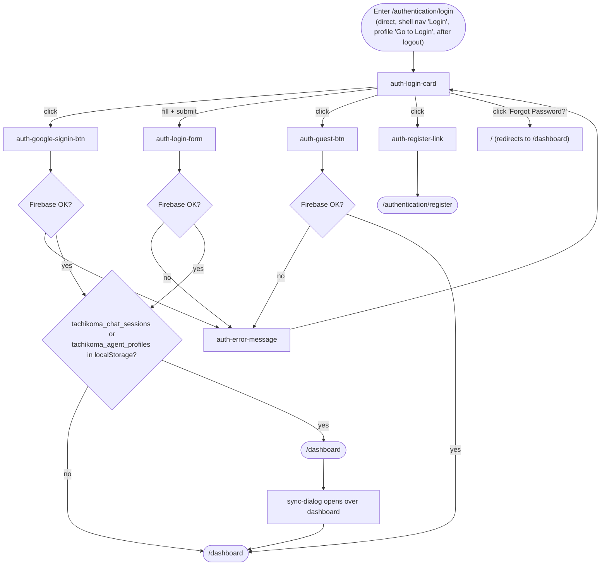

# Wireframe: Login (As-Built)

| Field | Value |
| :--- | :--- |
| **Status** | As-built reference (documents shipped code, not a forward spec) |
| **Version** | v1.0 |
| **Date** | 2026-11-23 |
| **Author** | Eunice (UI/UX Designer) |
| **Route** | `/authentication/login` (layout: `BlankComponent`, public) |
| **PRD module** | AUTH |
| **Stories / shards** | AUTH-001 (sign in and resume), AUTH-003 (first-login sync strategy, dialog opened from here) |
| **Source files** | `src/app/pages/authentication/side-login/side-login.component.html`, `side-login.component.ts`, `side-login.component.scss` |
| **Related** | [Flow_SignIn.md](Flow_SignIn.md), [Wireframe_Dialogs.md](Wireframe_Dialogs.md) (sync dialog), [Wireframe_Register.md](Wireframe_Register.md) |

## 1. Screen Purpose

The user picks one of three ways in (Google, email and password, or guest). Success means landing on `/dashboard` with an auth session. A real (non-anonymous) sign-in with local data on the device also opens the first-login sync dialog.

## 2. Mobile Layout (primary)

`BlankComponent` renders the page with no sidebar or header. On mobile, the `col-lg-4` card takes the full width.

```
+---------------------------------------+
|            [ SAC LOGO ]               |  <- link to /dashboard (sac-logo-white.png)
|---------------------------------------|
| [!] auth-error-message                |  <- only when errorMessage() is set
|---------------------------------------|
| [ G  Sign in with Google          ]   |  auth-google-signin-btn (stroked)
|                                       |
| ---------- or sign in with email ---- |
| Email                                 |
| [______________________________]      |  auth-email-input
|   "Email is required" / "valid email" |  mat-error (touched only)
| Password                              |
| [______________________________]      |  auth-password-input
| [ ] Remember this Device  Forgot Pwd? |  auth-remember-checkbox / link to "/"
| [        (spinner) Sign In        ]   |  auth-signin-submit-btn (flat primary)
|                                       |
|  New to Tachikoma? Create an account  |  auth-register-link
| ------------------ or --------------- |
| [ (user) Continue as Guest        ]   |  auth-guest-btn (stroked)
+---------------------------------------+
```

| Zone | Order | Approx. share |
| :--- | :--- | :--- |
| Logo | 1 | ~10% |
| Error alert (conditional) | 2 | ~5% |
| Google button | 3 | ~8% |
| Email form (`auth-login-form`) | 4 | ~50% |
| Register link | 5 | ~5% |
| Guest button | 6 | ~8% |

## 3. Desktop Layout

The layout is the same single card, centred in a `col-lg-4` column (about 33% of the viewport width) on a gradient background (`bg-gredient`). Nothing appears or hides between breakpoints; only the card width changes.

## 4. Component Inventory

| Component | Material or custom SCSS | Behaviour notes |
| :--- | :--- | :--- |
| Card | `mat-card` (`cardWithShadow boxed-auth`) | Static container, `data-test-id="auth-login-card"`. |
| Error alert | Custom `.alert.alert-error`, `role="alert"` | Rendered by `@if (errorMessage())`. The text comes from `AuthService.error()` or a fallback string. |
| Google button | `mat-stroked-button` | Calls `signInWithGoogle()` (Firebase popup). Disabled while `isLoading()`. |
| Email / password inputs | `mat-form-field` + `matInput` (outline), reactive form | Validators: email `required` + `email`, password `required`. Errors show only once the field is touched. |
| Remember checkbox | `mat-checkbox` | **Not bound to the form or to any logic.** It is decorative as shipped. |
| Forgot Password link | `<a routerLink="/">` | Goes to `/`, which redirects to `/dashboard`. There is no password-reset flow. |
| Submit button | `mat-flat-button` primary, `type="submit"` | Disabled when `isLoading() \|\| form.invalid`. Shows a `mat-spinner` (20px) while loading. |
| Register link | `<a routerLink="/authentication/register">` | |
| Guest button | `mat-stroked-button` | Calls `continueAsGuest()`, which runs Firebase `signInAnonymously`. |
| Sync dialog | `MatDialog` → `SyncDialogComponent` | Opened by an `effect()` when `authService.firstLogin() && isAuthenticated()`. See [Wireframe_Dialogs.md](Wireframe_Dialogs.md). |

## 5. Interaction & State Map

| Element | Default | Hover / focus | Active | Loading | Error / empty |
| :--- | :--- | :--- | :--- | :--- | :--- |
| `auth-google-signin-btn` | Enabled | Material stroked hover | Opens the Google popup | Disabled while `isLoading()` | Popup closed or blocked: `auth-error-message` shows a mapped message, for example "Sign-in popup was closed. Please try again." |
| `auth-email-input` | Empty | Outline focus ring | Typing | n/a | Touched and empty: "Email is required". Touched and invalid: "Please enter a valid email". |
| `auth-password-input` | Empty | Outline focus ring | Typing | n/a | Touched and empty: "Password is required". |
| `auth-remember-checkbox` | Unchecked | Material focus | Toggles visually | n/a | No effect (not wired). |
| `auth-signin-submit-btn` | Disabled until the form is valid | Flat hover | Submits the form | Spinner shown, button disabled | Firebase error is mapped by `AuthService.getErrorMessage()`, for example "Invalid credentials. Please check your email and password." |
| `auth-register-link` | Link | Underline/primary | Navigates to `/authentication/register` | n/a | n/a |
| `auth-guest-btn` | Enabled | Stroked hover | `signInAnonymously` | Disabled while `isLoading()` | "Guest sign-in failed. Please try again." or a mapped error |
| `auth-error-message` | Hidden | n/a | n/a | Cleared when an action starts (`errorMessage.set(null)`) | Visible with the message |

On success, all three sign-in paths call `router.navigate(['/dashboard'])`.

## 6. UX Flow Diagram



## 7. data-test-id Map

| Element | `data-test-id` | Condition |
| :--- | :--- | :--- |
| Login card container | `auth-login-card` | Always |
| Error alert | `auth-error-message` | `@if (errorMessage())` |
| Google sign-in button | `auth-google-signin-btn` | Always. Disabled while `isLoading()`. |
| Email form | `auth-login-form` | Always |
| Email input | `auth-email-input` | Always |
| Password input | `auth-password-input` | Always |
| "Remember this Device" checkbox | `auth-remember-checkbox` | Always (not wired to logic) |
| Sign In submit button | `auth-signin-submit-btn` | Always. Disabled while `isLoading() \|\| form.invalid`. |
| "Create an account" link | `auth-register-link` | Always |
| Continue as Guest button | `auth-guest-btn` | Always. Disabled while `isLoading()`. |

**Count: 10**

## Design Gaps

Interactive elements that have no `data-test-id` (proposed ids, for athena to implement):

| Element | Proposed `data-test-id` |
| :--- | :--- |
| Logo link to `/dashboard` | `auth-login-logo-link` |
| "Forgot Password?" link (routes to `/`) | `auth-login-forgot-link` |

## As-Built Observations (for owner / Jason)

1. "Remember this Device" is a checkbox with no binding and no behaviour.
2. "Forgot Password?" has no reset flow. It routes to `/`, which lands on the dashboard.
3. The sync dialog is opened by an `effect()` in this component, but `submit()` and `signInWithGoogle()` navigate to `/dashboard` straight away. The dialog relies on the effect running before the login component is destroyed. In practice it does appear over the dashboard (`e2e/helpers/auth.helper.ts` `resolveSyncDialog` waits for it). The "Sync failed, but you can continue using the app." message is set on this component's `errorMessage`, so it is probably never visible once the user has navigated away.
