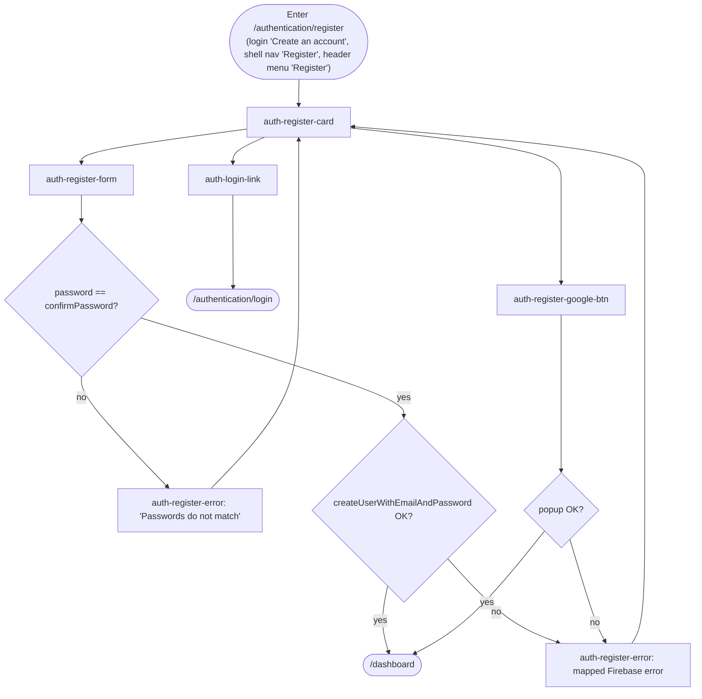

# Wireframe: Register (As-Built)

| Field | Value |
| :--- | :--- |
| **Status** | As-built reference |
| **Version** | v1.0 |
| **Date** | 2026-11-23 |
| **Author** | Eunice (UI/UX Designer) |
| **Route** | `/authentication/register` (layout: `BlankComponent`, public) |
| **PRD module** | AUTH |
| **Stories / shards** | AUTH-001 |
| **Source files** | `src/app/pages/authentication/side-register/side-register.component.html`, `side-register.component.ts` |
| **Related** | [Wireframe_Login.md](Wireframe_Login.md), [Flow_SignIn.md](Flow_SignIn.md) |

## 1. Screen Purpose

A new user creates an account with Google or with email and password. Success means the account exists, the user is signed in and lands on `/dashboard`.

## 2. Mobile Layout (primary)

```
+---------------------------------------+
|            [ DARK LOGO ]              |  <- link to /dashboard (dark-logo.svg)
|---------------------------------------|
| [!] auth-register-error               |  <- only when errorMessage() is set
|---------------------------------------|
| [ G  Sign up with Google          ]   |  auth-register-google-btn
| ---------- or sign up with email ---- |
| Email Address                         |
| [______________________________]      |  auth-register-email-input
| Password                              |
| [______________________________]      |  auth-register-password-input (min 6)
| Confirm Password                      |
| [______________________________]      |  auth-register-confirm-input
| [        (spinner) Sign Up        ]   |  auth-register-submit-btn
|                                       |
|  Already have an Account? Sign In     |  auth-login-link
+---------------------------------------+
```

## 3. Desktop Layout

The layout is the same single card in a `col-lg-4` column, centred on a gradient over `bg-light`. Nothing changes between breakpoints except the card width. Unlike the login page there is no guest button, and the logo asset is `dark-logo.svg` instead of `sac-logo-white.png`.

## 4. Component Inventory

| Component | Material or custom SCSS | Behaviour notes |
| :--- | :--- | :--- |
| Card | `mat-card` | `auth-register-card` |
| Error alert | Custom `.alert.alert-error`, `role="alert"` | Shows "Passwords do not match" (client check in `submit()`) or the mapped Firebase error. |
| Google button | `mat-stroked-button` | Calls `signInWithGoogle()`, then navigates to `/dashboard`. |
| Email / Password / Confirm | `mat-form-field` + `matInput` | Validators: email `required, email`; password `required, minLength(6)`; confirm `required`. Matching passwords is checked on submit, not as a validator. |
| Submit | `mat-flat-button` primary | Disabled when `isLoading() \|\| form.invalid`. Shows a spinner while loading. |
| Sign In link | `<a routerLink="/authentication/login">` | |

## 5. Interaction & State Map

| Element | Default | Hover / focus | Active | Loading | Error / empty |
| :--- | :--- | :--- | :--- | :--- | :--- |
| `auth-register-google-btn` | Enabled | Stroked hover | Google popup | Disabled | Mapped popup error in `auth-register-error` |
| `auth-register-email-input` | Empty | Focus ring | Typing | n/a | "Email is required" / "Please enter a valid email" |
| `auth-register-password-input` | Empty | Focus ring | Typing | n/a | "Password is required" / "Password must be at least 6 characters" |
| `auth-register-confirm-input` | Empty | Focus ring | Typing | n/a | "Please confirm your password". A mismatch shows only after submit, in `auth-register-error`. |
| `auth-register-submit-btn` | Disabled until valid | Flat hover | `registerWithEmail` | Spinner | "An account with this email already exists." and other mapped errors |
| `auth-login-link` | Link | Primary | Navigates to `/authentication/login` | n/a | n/a |

## 6. UX Flow Diagram



## 7. data-test-id Map

| Element | `data-test-id` | Condition |
| :--- | :--- | :--- |
| Register card container | `auth-register-card` | Always |
| Error alert | `auth-register-error` | `@if (errorMessage())` |
| Sign up with Google | `auth-register-google-btn` | Always. Disabled while `isLoading()`. |
| Register form | `auth-register-form` | Always |
| Email input | `auth-register-email-input` | Always |
| Password input | `auth-register-password-input` | Always |
| Confirm password input | `auth-register-confirm-input` | Always |
| Sign Up submit | `auth-register-submit-btn` | Always. Disabled while `isLoading() \|\| form.invalid`. |
| "Sign In" link | `auth-login-link` | Always |

**Count: 9**

## Design Gaps

| Element | Proposed `data-test-id` |
| :--- | :--- |
| Logo link to `/dashboard` | `auth-register-logo-link` |

## As-Built Observations

1. `registerWithEmail` and `signInWithGoogle` call `AuthService.checkForLocalData()`, which can set `firstLogin`. This page has no effect that opens the sync dialog, so **a sign-up never shows the first-login sync dialog**. The `firstLogin` flag stays set until the login page is next mounted while authenticated (see [Flow_SignIn.md](Flow_SignIn.md)).
2. The logo asset differs from the login page (`dark-logo.svg` vs `sac-logo-white.png`).
3. There is no guest option on this page.
