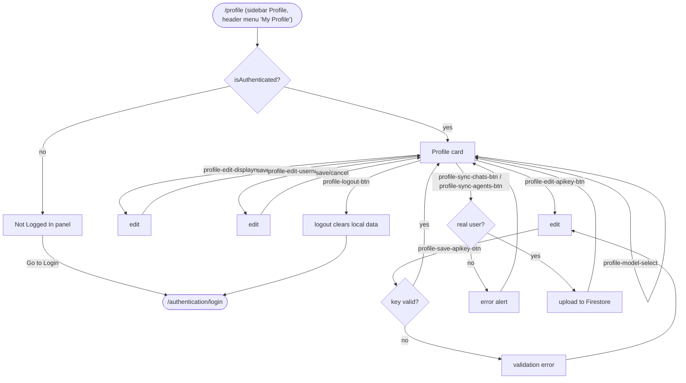

# Wireframe: User Profile (As-Built)

| Field | Value |
| :--- | :--- |
| **Status** | As-built reference |
| **Version** | v1.1 (stabilisation: API-key field deferred) |
| **Date** | 2026-11-24 (v1.0: 2026-11-23) |
| **Author** | Eunice (UI/UX Designer) |
| **Route** | `/profile` (layout: `FullComponent`, public route; content is gated in the template by `isAuthenticated()`) |
| **PRD modules** | AUTH (API key, logout), SYNC (manual cloud sync), OPER (rate-limit tier) |
| **Stories / shards** | AUTH-002, SYNC-001, SYNC-002 (manual sync utilities), OPER-002 (RPM tier feeds the status bar) |
| **Source files** | `src/app/pages/profile/profile.component.{html,ts,scss}` |

## 1. Screen Purpose

A signed-in user (including anonymous guests) manages their display name, chat username, Gemini API key, model and API tier. They can push local chats and agents to the cloud, or log out. Success means a green confirmation alert and the value persisted through `UserProfileService`.

## 2. Mobile Layout (primary)

```
+----------------------------------------------+
| (user-circle) User Profile                   |  mat-card header
|----------------------------------------------|
| [v] success alert   (auto-hides 3s)          |  successMessage()
| [!] error alert     (auto-hides 5s)          |  errorMessage()
|==============================================|
| @if (isAuthenticated())                      |
|  [avatar photo | placeholder icon]           |
|  Email           user@x.com (read-only)      |
|  Display Name    Jane            [edit]      |  profile-edit-displayname-btn
|     (edit: [______] [save] [x])              |  -save- / -cancel-displayname-btn
|  Chat Username   USER            [edit]      |  profile-chat-username-preview / profile-edit-username-btn
|     (edit: [______] max 20 [save] [x])       |  -save- / -cancel-username-btn
|  Member Since    <date>                      |  @if (profile()?.createdAt)
|----------------------------------------------|
|  (robot) AI Settings                         |
|  Google AI API Key  (key) AIza****1234 [edit]|  profile-edit-apikey-btn  (DEFERRED: Firebase AI Logic)
|     (edit: [pwd____] [save|spinner] [x])     |  -save- / -cancel-apikey-btn
|     [!] validation error                     |
|  Gemini Model     [select v]                 |  profile-model-select
|  API Tier / Rate Limit [Free 15/min v]       |  (no id)
|----------------------------------------------|
|  (cloud) Data Sync                           |
|  [spinner] syncing chats message             |
|  Chat Sessions  <copy>                       |
|  [ Sync Chats to Cloud ]                     |  profile-sync-chats-btn
|  Agent Profiles <copy>                       |
|  [ Sync Agents to Cloud ]                    |  profile-sync-agents-btn
|----------------------------------------------|
|  [ (logout) Logout ]                         |  profile-logout-btn
|==============================================|
| @else                                        |
|  (user-x) Not Logged In                      |
|  Please log in to view and manage ...        |
|  [ Go to Login ]                             |  (no id)
+----------------------------------------------+
```

## 3. Desktop Layout

The same single `mat-card`, centred in `.profile-container`. Rows are label/value pairs; `.highlight` rows (Chat Username, API Key, Rate Limit) get an accent background. Nothing changes between breakpoints.

## 4. Component Inventory

| Component | Material or custom SCSS | Behaviour notes |
| :--- | :--- | :--- |
| Card | `mat-card` | |
| Alerts | Custom `.alert-success` / `.alert-error` / `.alert-info` | Success clears after 3s; errors after 5s. The sync-info alerts include a `mat-spinner`. |
| Inline editors (display name, username, API key) | `mat-form-field` + `matInput`, `mat-icon-button` save/cancel | Signals `editingX()` toggle view and edit. Username has `maxlength="20"`; an empty username gives "Chat username cannot be empty." The API key is `type=password`, validated by `validateGeminiApiKey` before saving; the save button shows a spinner while `isValidatingApiKey()`. |
| Model select | `mat-select` | `GEMINI_MODELS`; default `models/gemini-3.5-flash`. Saves on `selectionChange`. |
| Rate-limit select | `mat-select` | 15 (Free) / 60 (Pay-as-you-go) / 1000 (Paid). Saves on `selectionChange`. Feeds the status bar RPM denominator. |
| Sync buttons | `mat-stroked-button` (primary / accent) | Disabled while syncing or `isLoading()`. **Real users only**: anonymous users get "Please log in with a real account to sync chats." The buttons are still shown to guests. |
| Logout | `mat-flat-button` warn | `authService.logout()` clears local chats, agents, key and profile, then goes to `/authentication/login`. |
| Not-logged-in panel | Custom `.not-logged-in` + `mat-flat-button` | "Go to Login" goes to `/authentication/login`. |

## 5. Interaction & State Map

| Element | Default | Hover / focus | Active | Loading | Error / empty |
| :--- | :--- | :--- | :--- | :--- | :--- |
| `profile-edit-displayname-btn` | View mode | Focus | Switches to edit | n/a | n/a |
| `profile-save-displayname-btn` | Edit mode | Focus | Saves | Disabled while `isLoading()` | "Failed to update display name..." |
| `profile-cancel-displayname-btn` | Edit mode | Focus | Back to view | n/a | n/a |
| `profile-edit-username-btn` / `-save-` / `-cancel-` | Same pattern | | | | Empty: "Chat username cannot be empty." |
| `profile-chat-username-preview` | Shows `chatUsername` or `USER` | n/a | n/a | n/a | Falls back to `USER` |
| `profile-edit-apikey-btn` (Deferred: Firebase AI Logic migration) | Masked key or "Not set" | Focus | Edit | n/a | n/a |
| `profile-save-apikey-btn` (Deferred: Firebase AI Logic migration) | Edit mode | Focus | Validates, then saves | Spinner, disabled | `mat-error` + `.validation-error` with the message; empty: "API key cannot be empty." |
| `profile-cancel-apikey-btn` (Deferred: Firebase AI Logic migration) | Edit mode | Focus | Back to view | Disabled while validating | n/a |
| `profile-model-select` | Current model | Focus | Saves on change | n/a | Error alert |
| Rate-limit select (no id) | Current RPM | Focus | Saves on change | n/a | "Failed to save rate limit..." |
| `profile-sync-chats-btn` | Enabled | Hover | Manual upload | Spinner + "Syncing..." + info alert | Guest: real-account error. "No chats to sync." Partial failures reported. |
| `profile-sync-agents-btn` | Enabled | Hover | Manual upload | Spinner + "Syncing..." | Same pattern |
| `profile-logout-btn` | Enabled | Hover | Logout, then login page | n/a | "Failed to logout. Please try again." |

## 6. UX Flow Diagram



## 7. data-test-id Map

Re-read from the final template state on 2026-11-23.

| Element | `data-test-id` | Condition |
| :--- | :--- | :--- |
| Save display name | `profile-save-displayname-btn` | `isAuthenticated()` and `editingDisplayName()` |
| Cancel display name edit | `profile-cancel-displayname-btn` | `isAuthenticated()` and `editingDisplayName()` |
| Edit display name | `profile-edit-displayname-btn` | `isAuthenticated()` and `!editingDisplayName()` |
| Save chat username | `profile-save-username-btn` | `editingChatUsername()` |
| Cancel chat username edit | `profile-cancel-username-btn` | `editingChatUsername()` |
| Chat username preview | `profile-chat-username-preview` | `!editingChatUsername()` |
| Edit chat username | `profile-edit-username-btn` | `!editingChatUsername()` |
| Save API key (Deferred: Firebase AI Logic migration) | `profile-save-apikey-btn` | `editingApiKey()`. Disabled while validating. |
| Cancel API key edit (Deferred: Firebase AI Logic migration) | `profile-cancel-apikey-btn` | `editingApiKey()` |
| Edit API key (Deferred: Firebase AI Logic migration) | `profile-edit-apikey-btn` | `!editingApiKey()` |
| Model select | `profile-model-select` | `isAuthenticated()` |
| Sync chats button | `profile-sync-chats-btn` | `isAuthenticated()` |
| Sync agents button | `profile-sync-agents-btn` | `isAuthenticated()` |
| Logout button | `profile-logout-btn` | `isAuthenticated()` |

**Count: 14**

## Design Gaps

| Element | Proposed `data-test-id` |
| :--- | :--- |
| Display name input | `profile-displayname-input` |
| Chat username input | `profile-username-input` |
| API key input | `profile-apikey-input` (Deferred: Firebase AI Logic migration) |
| API tier / rate-limit select | `profile-ratelimit-select` |
| "Go to Login" button (not logged in) | `profile-goto-login-btn` |

Recommended non-interactive hooks:

| Element | Proposed `data-test-id` |
| :--- | :--- |
| Success alert | `profile-success-message` |
| Error alert | `profile-error-message` |
| API key validation error | `profile-apikey-error` (Deferred: Firebase AI Logic migration) |
| Masked API key preview | `profile-apikey-preview` (Deferred: Firebase AI Logic migration) |
| Email value | `profile-email-value` |
| Chat / agent sync progress alerts | `profile-sync-chats-status`, `profile-sync-agents-status` |
| Not-logged-in panel | `profile-not-logged-in` |

## As-Built Observations

1. The manual sync buttons are shown to anonymous guests but reject them with an error. Consider hiding or disabling them (owner decision).
2. The profile route has no guard. It relies on the template `@if (isAuthenticated())`.
